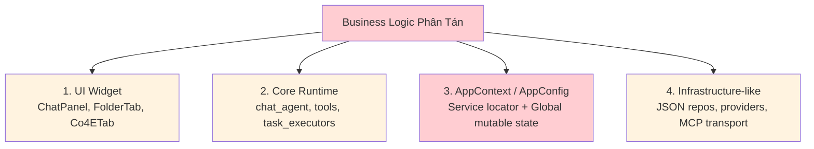
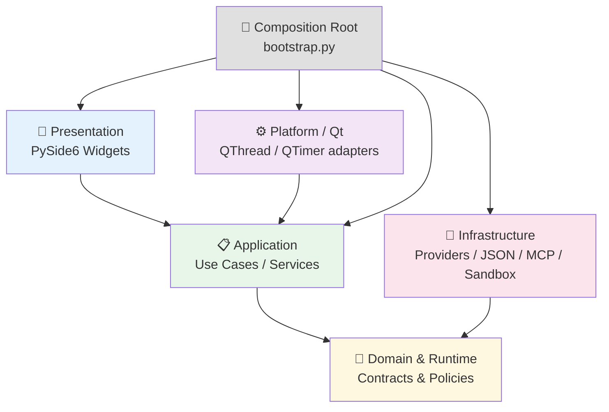
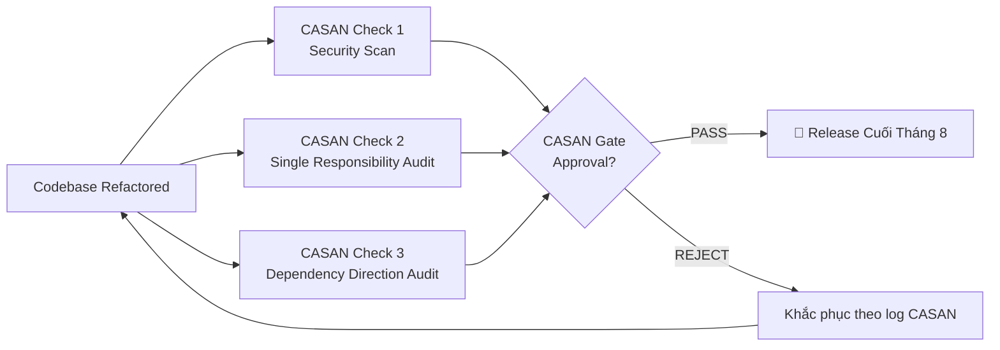
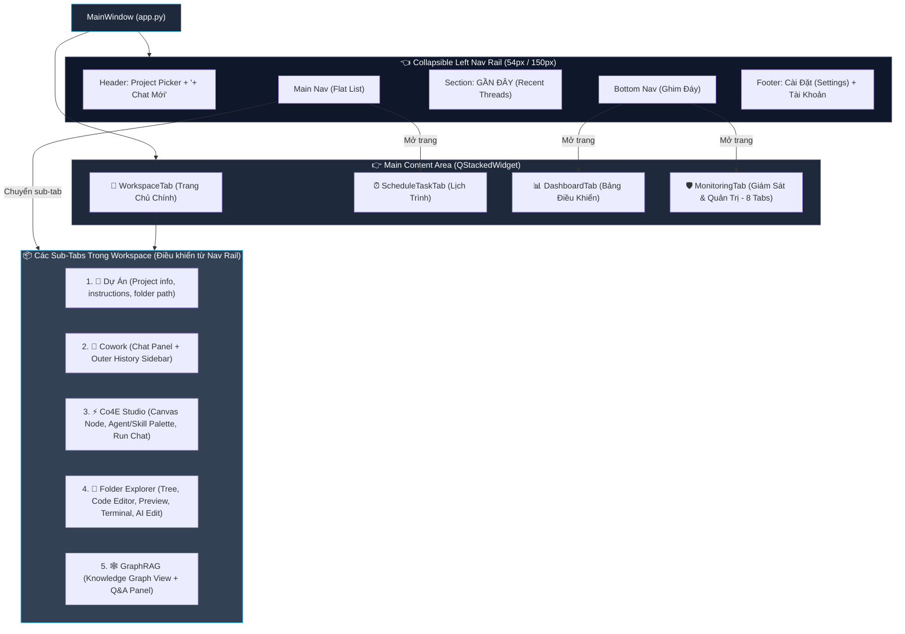
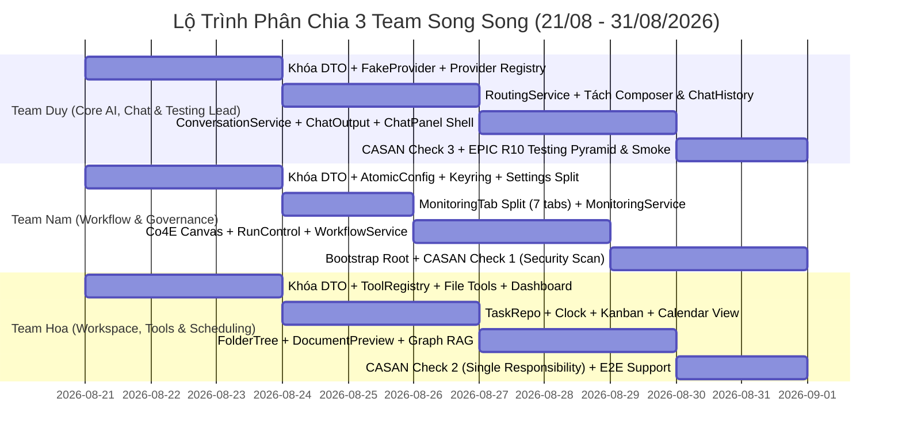

# COWORK LOCAL - TÀI LIỆU PHÂN TÍCH & KẾ HOẠCH TÁI CẤU TRÚC TOÀN DIỆN
## (ARCHITECTURE AUDIT & REFACTORING MASTER PLAN 2026)

**Tên dự án**: Cowork Local (Cowork-Local BamBOO)  
**Thời gian thực hiện**: 21/08/2026 ➔ 31/08/2026  
**Phân công lực lượng**: 
- 🔵 **Team Duy**: Tech Lead, Core AI, Routing, Turn Runtime & Testing Pyramid (Chủ trì R01, R03, R04, R10)
- 🟣 **Team Nam**: Automation Workflows, Co4E Studio, Monitoring 8 tabs, Settings & Governance (Chủ trì R02, R08, R09)
- 🟢 **Team Hoa**: Workspace Project Manager, Folder Explorer, Scheduling Kanban, Dashboard & Tools (Chủ trì R05, R06, R07, R08)
**Cơ chế kiểm duyệt**: CASAN Verification Gate  
**Checklist theo dõi tiến độ**: `Refactoring_Checklist.md`  
**Nguyên tắc cốt lõi**: **Single Responsibility & Contract-First (Zero Blocking)**

---

## 📌 I. TÓM TẮT THỰC TRẠNG (EXECUTIVE SUMMARY)

Cowork Local là ứng dụng Desktop Python/PySide6 chạy local-first với khoảng **162 file được index, ~45.000 dòng Python** và 81 unit tests pass. Mặc dù đã có các module riêng cho runtime, provider, MCP, workspace và persistence, **UI vẫn đang trực tiếp điều phối quá nhiều tầng xử lý**, dẫn đến:

- Một file duy nhất xử lý quá nhiều tác vụ không liên quan (God Class / God File).
- Không có ranh giới dependency rõ ràng giữa Presentation và Business Logic.
- Business logic bị phân tán ở 4 vùng đan xen.

> **Quan điểm chủ đạo**: Bài toán cốt lõi không phải là "di chuyển file" mà là **chia nhỏ trách nhiệm xử lý sao cho mỗi file/class chỉ làm 1 việc rõ ràng** và các tầng có dependency direction đúng.

---

## 🔍 II. KIỂM TRA TRỰC TIẾP SOURCE CODE (CONCRETE CODE AUDIT)

### 1. Danh Sách File "Quá Nhiều Tác Vụ" (God File / Monolithic)

Đây là các file vi phạm nghiêm trọng nguyên tắc Single Responsibility, **1 file đang xử lý quá nhiều mối quan tâm**:

| File | Kích Thước | Số Dependency | Vấn Đề Cụ Thể |
| :--- | :--- | :--- | :--- |
| **`ui/chat_panel.py`** | ~87KB, 1.739 dòng | **21 module** | Trộn lẫn: render Markdown, xử lý file đính kèm, gọi LLM Agent, quản lý hàng đợi, ghi lịch sử, ghi âm Audio, routing UI — **tất cả trong 1 class** |
| **`ui/co4e_tab.py`** | ~86KB, >2.000 dòng | **15 module** | Trộn lẫn: Canvas vẽ đồ thị Node, quản lý luồng thực thi, CRUD workflow, gọi Provider/routing, ghi audit, ghi Usage — **tất cả trong 1 class** |
| **`ui/folder_tab.py`** | ~74KB, >1.800 dòng | **16 module** | Trộn lẫn: File tree, xem trước PDF/Excel, Syntax Highlight, AI edit, Terminal, gọi routing/provider, ghi file, image generation — **tất cả trong 1 class** |
| **`app.py::MainWindow`** | ~41KB | **20 module** | Vừa là Navigation shell, vừa là Composition root, vừa owner TaskScheduler, vừa quản lý tray/lifecycle/settings/notifications |
| **`state.py::AppContext`** | ~14KB | **Fan-in rất cao** | Service Locator toàn cục — widget tự lấy bất kỳ service nào thông qua 1 đối tượng. Background job có thể đọc state đã bị thay đổi bởi UI thread |
| **`config.py::AppConfig`** | ~27KB | **Impact: 310 symbol** | Untyped nested dict, bị mutate từ mọi nơi, save không atomic, lưu cả API Key plaintext |
| **`core/tools.py`** | ~25KB | — | Giant `if/elif` dispatcher: handler, schema, capability, audit không được đặt cùng nhau |
| **`core/task_executors.py`** | ~23KB | **16 module** | Vừa dispatch type, vừa orchestration, vừa persistence, vừa notification |

### 2. Business Logic Đang Bị Phân Tán Ở 4 Vùng



**Không có Application Layer ổn định đứng giữa PySide6 và runtime/infrastructure.**

### 3. Các Vấn Đề Kỹ Thuật Cụ Thể (Evidence với Dòng Code)

#### 3.1 Rò Rỉ PySide6 vào Backend Logic (`core/`)
- 📍 **`core/worker.py` (Dòng 12)**: `from PySide6.QtCore import QThread, Signal`
- 📍 **`core/task_scheduler.py` (Dòng 20)**: `from PySide6.QtCore import QCoreApplication, QObject, QTimer, Signal`
- 📍 **`core/co4e_run_manager.py` (Dòng 20)**: `from PySide6.QtCore import QObject, Signal`
- 📍 **`core/routing/scheduler.py` (Dòng 19)**: `from PySide6.QtCore import QObject, QTimer, Signal`

> ➡️ **Hệ quả**: Không thể viết unit test `pytest` độc lập mà không cần khởi tạo Qt GUI.

#### 3.2 I/O File Lớn Chạy Trực Tiếp Trên Main UI Thread (Gây Đơ UI)
- 📍 **`ui/folder_tab.py` (Dòng 1566)**: `with open(path, "rb") as f:` đọc file nhị phân lớn trực tiếp trên Main Thread.
- 📍 **`ui/libreoffice_view.py` (Dòng 154, 260)**: `subprocess.Popen(args)` gọi LibreOffice từ UI thread.

#### 3.3 Routing Logic Bị Lặp Lại Ở 3 Vị Trí Khác Nhau
- `ChatPanel._apply_routing` (Cowork)
- `Co4ETab._apply_co4e_routing` (Co4E)
- `FolderTab._ai_apply_routing` (Folder)

> ➡️ **Hệ quả**: Sửa một bug hoặc thay đổi policy routing phải chỉnh 3 nơi khác nhau.

#### 3.4 Circular Import (Vòng Phụ Thuộc Tròn)
| Chu Kỳ | Nguyên Nhân | Hướng Xử Lý |
| :--- | :--- | :--- |
| `core.model_pricing` ↔ `core.usage_tracker` | Pricing và usage dùng format/defaults của nhau | Tách value types/rate calculation; usage writer chỉ ghi event |
| `core.agent_security` ↔ `core.agent_security_alert` | Security decision và alert notification tham chiếu ngược | Security policy trả event/decision; presentation adapter quyết định alert |

#### 3.5 >240 Vị Trí `except Exception:` Nuốt Lỗi
- 📍 **`ui/folder_tab.py`**: 15 vị trí (dòng 42, 49, 476, 493, 517, 616, 633, 666, 804, 858, 953, 1138, 1221, 1419, 1523)
- 📍 **`ui/libreoffice_view.py`**: 9 vị trí (dòng 155, 179, 202, 227, 235, 246, 249, 262)
- 📍 **`ui/monitoring_tab.py`**: 4 vị trí (dòng 714, 722, 731, 736)

#### 3.6 Vấn Đề Bảo Mật
- API keys/tokens lưu **plaintext** trong `config.json` (`A18`).
- AI-assisted guardrail (`core/agent_security.py`) **fail-open theo thiết kế** — không thể coi là hard security boundary (`A19`).
- Hai namespace security chồng lấn: `core/agent_security*.py` và `security/*` (`A14`).

---

## 🏛️ III. KIẾN TRÚC MỤC TIÊU (TARGET ARCHITECTURE)

### 1. Tại Sao KHÔNG Chia "Frontend/Backend"?

Cowork Local là **1 desktop process duy nhất** — không có network API boundary nội bộ. Gọi là "backend" hay "frontend" theo kiểu Web App sẽ gom quá nhiều thứ vào 1 hộp không rõ ranh giới và không giải quyết được vấn đề dependency direction.

**Tên phù hợp hơn (Clean Architecture cho Desktop):**

| Tầng | Trách Nhiệm | KHÔNG bao gồm |
| :--- | :--- | :--- |
| **Presentation** | Render state/event, thu input user, navigation, dialog confirm | Provider calls, JSON save, tool orchestration, path resolution |
| **Application** | Điều phối 1 use case, map DTO, request policy decision | Qt widget, SDK-specific response, raw config dict |
| **Domain & Runtime** | Agent contracts, tool/policy types, workspace types, deterministic policies | Filesystem, network, UI, global state |
| **Infrastructure** | Provider/MCP/REST clients, JSON repositories, config, sandbox, audit | Product navigation hay screen state |
| **Platform / Composition** | QApplication, QThread/QTimer adapters, lifecycle, dependency wiring | Business rules, feature CRUD |

### 2. Sơ Đồ Dependency Direction Mục Tiêu



**Quy tắc bắt buộc:**
- **Domain/Runtime** không import PySide6, concrete provider, `AppConfig` hay `Path` repository.
- **Application** không lấy dependency từ global `AppContext`; dependency được inject qua constructor.
- **Presentation** không gọi provider, filesystem repository hay MCP client trực tiếp.
- **Infrastructure** implement port từ domain/application; không import widget.
- Chỉ **Composition Root** biết cả concrete UI lẫn concrete infrastructure.

### 3. Cấu Trúc Thư Mục Mục Tiêu (Target Folder Structure)

```text
cowork_local/
│
├── bootstrap.py                       # Composition Root: nối Presentation + Application + Infrastructure
├── presentation/                      # 🎨 Tầng Giao Diện (PySide6)
│   ├── shell/                         # MainWindow, Sidebar, Tray, Settings (mỗi class 1 file)
│   ├── dashboard/                     # Dashboard views
│   ├── scheduling/                    # Schedule tab, Calendar, Task viewer
│   ├── workspace/                     # Project selector, WorkspaceTab shell
│   ├── chat/                          # ChatHistoryWidget, AttachmentPicker, ComposerWidget (tách nhỏ từ ChatPanel)
│   ├── co4e/                          # Co4ECanvasWidget, NodePropertyPanel (tách nhỏ từ Co4ETab)
│   ├── folder/                        # WorkspaceFileTree, DocumentPreviewManager (tách nhỏ từ FolderTab)
│   ├── graph/                         # StructureGraphView
│   ├── monitoring/                    # Monitoring views (mỗi tab 1 file)
│   ├── settings/                      # SettingsDialog (tách thành nhiều section widget)
│   └── shared/                        # Icons, Widgets, Theme, RoutingToggle
│
├── application/                       # 📋 Tầng Use Case / Application Services (Pure Python)
│   ├── conversations/                 # ConversationApplicationService (điều phối 1 turn chat)
│   ├── model_routing/                 # RoutingApplicationService (1 đường routing duy nhất)
│   ├── workspaces/                    # WorkspaceSessionService (snapshot immutable per-turn)
│   ├── scheduling/                    # TaskApplicationService (tách khỏi Qt timer)
│   ├── workflows/                     # Co4EWorkflowService, FlowService
│   ├── connectors/                    # ConnectorApplicationService
│   ├── monitoring/                    # MonitoringQueryService (read-only)
│   └── settings/                      # SettingsApplicationService, SecretStore facade
│
├── domain/                            # 🧠 Tầng Domain (Pure Python - không import Qt / concrete infra)
│   ├── agents/                        # ConversationExecutionRequest, AgentEvent, AgentResult
│   ├── models/                        # ProviderDescriptor, ToolSpec, RoutingRequest/Result
│   ├── tools/                         # ToolDescriptor, ToolCapability, ToolPolicy
│   ├── workspaces/                    # WorkspaceSession, WorkspaceRepository port
│   ├── tasks/                         # TaskRepository port, Clock port, TaskExecutionService
│   ├── workflows/                     # WorkflowDefinitionRepository, WorkflowRunner port
│   └── security/                      # SecurityPolicy (deterministic fail-closed), AuditSink port
│
├── infrastructure/                    # 🔧 Tầng Infrastructure (Implement domain ports)
│   ├── providers/                     # OpenAI, Anthropic, Ollama, FPT Gateway adapters
│   ├── mcp/                           # MCP client/transport adapter
│   ├── connectors/                    # REST, MS365, Jira connector adapters
│   ├── persistence/
│   │   └── json/                      # AtomicJsonFile, JSONL writer, repository implementations
│   ├── filesystem/                    # File scan, doc extraction, sandbox executor
│   ├── config/                        # AppConfig repository (atomic read/write)
│   ├── secrets/                       # OS Keyring adapter, SecretStore implementation
│   ├── sandbox/                       # Sandbox manager, WinJob, integrity adapters
│   ├── telemetry/                     # UsageSink, AuditLogger (canonical schema)
│   └── documents/                    # PDF/PPTX/Excel extract adapters
│
└── platform/
    └── qt/                            # AgentWorker (QThread adapter), QtSchedulerClock (QTimer adapter)
```

---

## 📋 IV. DANH SÁCH CÁC FILE "GỌN LẠI" (FILE DECOMPOSITION PLAN)

> **Cơ sở phân tích**: Dựa trên `function_list.md` — danh sách 200+ function được phân loại theo màn hình — kết hợp với CodeGraph dependency analysis. Mỗi function được phân về đúng file/class có trách nhiệm tương ứng.

Danh sách cụ thể các file đang xử lý quá nhiều tác vụ cần được **chia nhỏ**:

### Chia Nhỏ `ui/chat_panel.py` (~87KB, 1.739 dòng, 21 dependencies)

**Trước (1 file làm hết):**
```text
ui/chat_panel.py  ← Render tin nhắn + Attachment + Call Agent + Audio + Queue + History + Usage
```

**Sau (mỗi file 1 tác vụ):**
```text
presentation/chat/
├── chat_history_widget.py          # Chỉ render danh sách tin nhắn (scroll, bubble)
├── message_item_renderer.py        # Chỉ render 1 tin nhắn (Markdown, code block, tool call)
├── attachment_picker.py            # Chỉ xử lý đính kèm file/image
├── composer_widget.py              # Chỉ xử lý ô nhập liệu và gửi
├── audio_recorder_widget.py        # Chỉ xử lý ghi âm
└── chat_panel.py                   # Chỉ là container lắp ráp các widget trên
```

### Chia Nhỏ `ui/co4e_tab.py` (~86KB, >2.000 dòng, 15 dependencies)

**Trước (1 file làm hết):**
```text
ui/co4e_tab.py  ← Canvas Node + Editor CRUD + Run Manager + Chat + Routing + Usage
```

**Sau (mỗi file 1 tác vụ):**
```text
presentation/co4e/
├── co4e_canvas_widget.py           # Chỉ vẽ và tương tác canvas đồ thị Node
├── node_property_panel.py          # Chỉ hiển thị/chỉnh thuộc tính 1 Node
├── co4e_run_status_widget.py       # Chỉ hiển thị tiến độ chạy đồ thị
└── co4e_tab.py                     # Chỉ là container lắp ráp
application/workflows/
└── co4e_workflow_service.py        # Chỉ xử lý CRUD, run, event dispatch (Pure Python)
```

### Chia Nhỏ `ui/folder_tab.py` (~74KB, >1.800 dòng, 16 dependencies)

**Trước (1 file làm hết):**
```text
ui/folder_tab.py  ← File Tree + Preview + Syntax + AI Edit + Terminal + Routing + Image Gen
```

**Sau (mỗi file 1 tác vụ):**
```text
presentation/folder/
├── workspace_file_tree.py          # Chỉ hiển thị cây thư mục
├── document_preview_manager.py     # Chỉ xem trước file (PDF, Office, Text, Image)
├── ai_file_editor_dialog.py        # Chỉ dialog xác nhận và apply AI edit
└── folder_tab.py                   # Chỉ là container lắp ráp
application/workspaces/
└── file_workspace_service.py       # Chỉ xử lý AI edit use case (Pure Python)
```

### Chia Nhỏ `app.py::MainWindow`

**Trước**: MainWindow = Navigation + Composition root + Scheduler + Tray + Settings + Notifications + Shutdown MCP

**Sau:**
```text
bootstrap.py                        # Khởi tạo toàn bộ dependency và nối với nhau
presentation/shell/
├── main_window.py                  # Chỉ navigation shell + tab switching
├── tray_manager.py                 # Chỉ quản lý System Tray icon/menu
├── notification_adapter.py         # Chỉ hiển thị notification cho người dùng
└── lifecycle_coordinator.py        # Chỉ shutdown sequence (MCP, scheduler, Qt)
```

### Chia Nhỏ `core/tools.py` (Giant if/elif dispatcher)

**Trước:**
```text
core/tools.py  ← if tool == "run_command": ... elif tool == "read_file": ... (25KB của if/elif)
```

**Sau:**
```text
domain/tools/
├── tool_registry.py               # Đăng ký descriptor + executor + capability
infrastructure/filesystem/
├── file_tools.py                  # read_file, write_file, edit_file handlers
├── command_tools.py               # run_command, install_package handlers
├── fetch_tools.py                 # link_fetch, jira_tool handlers
└── image_tools.py                 # image_gen handler
```

### Chia Nhỏ `core/task_executors.py`

**Trước**: `task_executors.py` = dispatch type + orchestration + persistence + notification

**Sau:**
```text
application/scheduling/
├── task_application_service.py    # Chỉ điều phối 1 task (dispatch type, trả event)
domain/tasks/
├── task_execution_service.py      # Chỉ chứa business rule về execution
infrastructure/persistence/json/
└── task_repository.py             # Chỉ đọc/ghi task JSON
```

### Chia Nhỏ `ui/schedule_task_tab.py` (Kanban + Calendar + AI Create + Import)

**Trước (1 file làm hết):**
```text
ui/schedule_task_tab.py  ← Kanban Board + Calendar View + Add/AI Create Task + AI Import
```

**Sau (mỗi file 1 tác vụ):**
```text
presentation/scheduling/
├── kanban_board_widget.py        # Chỉ render và tương tác Kanban 7 cột
│                                  # (_build_kanban, _render_kanban, _on_task_dropped, _on_card_*,
│                                  #  _bulk_delete_menu, _search_tasks, _filter_by_type)
├── calendar_view_widget.py       # Chỉ render Calendar view
│                                  # (_build_calendar, _shift, add_task_on_date, edit_task)
├── ai_task_creator_dialog.py     # Chỉ dialog AI tạo task tự động
│                                  # (_ai_create_task, _ai_pick_files, _generate, _on_planned, _confirm)
├── ai_task_import_dialog.py      # Chỉ dialog AI import tasks từ file/link
│                                  # (_ai_import, _ai_pick_import_files, _generate_import, _on_import_planned)
└── schedule_task_tab.py          # Chỉ là container lắp ráp + toolbar

application/scheduling/
├── task_application_service.py   # CRUD + dispatch: _run_now, _duplicate_task, _pause_task,
│                                  #  _delete_task → Pure Python, không Qt
└── ai_task_planner_service.py    # Chỉ gọi AI để generate task plan (Pure Python)
```

### Chia Nhỏ `ui/dashboard_tab.py` (Token Usage + Charts + AI Analyze)

**Trước (1 file làm hết):**
```text
ui/dashboard_tab.py  ← Token Cards + Spline Chart + Budget + Habits + AI Analyze
```

**Sau (mỗi file 1 tác vụ):**
```text
presentation/dashboard/
├── token_usage_card_widget.py    # Chỉ hiển thị thẻ thống kê Total/Input/Output/Cache
│                                  # (_refresh_cards, _refresh_budget, _apply_budget)
├── usage_chart_widget.py         # Chỉ vẽ biểu đồ spline theo chu kỳ
│                                  # (_refresh_chart, _chart_prev, _chart_next, _on_gran_changed)
├── habits_widget.py              # Chỉ hiển thị thói quen sử dụng
│                                  # (_refresh_habits)
└── dashboard_tab.py              # Chỉ là container lắp ráp

application/monitoring/
└── dashboard_query_service.py    # Chỉ query usage/cost data (Pure Python)
                                   # (_ai_analyze, _apply_saving_strategy)
```

### Chia Nhỏ `ui/monitoring_tab.py` (8 Admin Views)

**Trước (1 file làm hết):**
```text
ui/monitoring_tab.py  ← Overview + Security Events + MCP History + Action Logs +
                         Agent Status + Security Settings (6 concerns trong 1 file)
```

**Sau (mỗi view 1 file):**
```text
presentation/monitoring/
├── overview_tab.py               # _refresh_overview, _refresh_usage_cards,
│                                  # _refresh_resource_usage, _refresh_recent_activity
├── sandbox_status_tab.py         # _refresh_sandbox_details, _refresh_permissions, _apply_budget
├── security_events_tab.py        # _refresh_security_events, _filter_security_events, _sort_events
├── mcp_history_tab.py            # _refresh_mcp_calls, _filter_mcp_calls
├── action_logs_tab.py            # _refresh_action_logs, _filter_action_logs, _sort_action_logs
├── agent_status_tab.py           # _refresh_agent_status
├── security_settings_tab.py      # _toggle_sandbox, _toggle_network_block, _set_resource_limits,
│                                  # _toggle_command_confirm, _manage_permissions
└── monitoring_tab.py             # Chỉ là container + tab switcher
```

### Chia Nhỏ `ui/settings_dialog.py` (AI Provider + Connectors + Routing + General)

**Trước (1 file làm hết):**
```text
ui/settings_dialog.py  ← Provider config + MCP server + Routing params + General settings
```

**Sau (mỗi section 1 file):**
```text
presentation/settings/
├── provider_settings_widget.py   # _on_provider_changed, _load_models, _test_connection,
│                                  # _stash_provider_fields, _apply_provider_fields, Model List Widget
├── connector_settings_widget.py  # _add_mcp_server, _edit_mcp_server, _delete_mcp_server,
│                                  # _test_mcp_connection, MS365/CAD connectors
├── routing_settings_widget.py    # routing_mode, routing_policy, routing_min_gain,
│                                  # routing_timeout, routing_interval, routing_concurrency, routing_judge
├── general_settings_widget.py    # Language Picker, tray_chk, notify_chk, _save
└── settings_dialog.py            # Chỉ là container + OK/Cancel buttons
```

---

## 🛡️ V. QUY TRÌNH KIỂM DUYỆT BỞI CASAN (CASAN VERIFICATION GATE)

Sau khi refactor, toàn bộ codebase mới bắt buộc phải vượt qua **3 bước CASAN Check** trước khi nghiệm thu:



| CASAN Check | Nội Dung Kiểm Tra | Tiêu Chí PASS |
| :--- | :--- | :--- |
| **Check 1: Security Scan** | Rà soát API Key/Token không lưu plaintext trong `config.json`; guardrails gọi qua policy gateway; TLS trust hợp lệ | 0 credential plaintext trong JSON files |
| **Check 2: Single Responsibility Audit** | Mỗi file production không vượt quá **400 dòng**; không có class đảm nhận >3 tác vụ khác loại | 0 file >400 dòng trong `presentation/`, `application/`, `domain/` |
| **Check 3: Dependency Direction Audit** | Quét tĩnh: `domain/` và `application/` không import `PySide6`; `presentation/` không gọi JSON repo hay provider trực tiếp | 0 dependency rule violation trong code mới |

---

## 🗓️ VI. LỘ TRÌNH THỰC HIỆN - 10 EPIC (REFACTORING ROADMAP)

### Bảng Tổng Quan 10 EPIC

| EPIC | Tên | Dependency | Giá Trị Kiến Trúc |
| :--- | :--- | :--- | :--- |
| **R01** | Architecture Foundation & Characterization | Không | Safety net + ngôn ngữ chung trước khi nhiều người sửa |
| **R02** | Configuration, Secrets & Persistence | R01 | Loại bỏ global dict/direct write và bảo vệ credential |
| **R03** | Model Providers & Routing | R01, R02 | 1 đường mở rộng provider, 1 routing flow duy nhất |
| **R04** | Agent Runtime & Conversation Service | R01, R03 | Tách turn lifecycle khỏi widget |
| **R05** | Tool, MCP & Connector Policy | R01, R04 | 1 security/approval path cho mọi tool call |
| **R06** | Workspace, Filesystem & History Isolation | R01, R02 | Loại bỏ cross-project mutable path/state |
| **R07** | Scheduling & Workflow Runtime | R01, R04, R06 | Tách Qt timer, persistence và runtime dispatch |
| **R08** | UI/Application Separation | R03 - R07 | Thu nhỏ God widgets theo từng screen |
| **R09** | Security Runtime, Sandbox & Observability | R01, R05 | Policy rõ, event schema thống nhất |
| **R10** | Testing, Packaging & Contributor Experience | Tất cả | CI, docs, contributor có thể sửa 1 capability độc lập |

---

### 💡 Chiến Lược Triển Khai Song Song 100% Cho 3 Team (Zero Blocking)

Để 3 team làm việc cùng lúc từ **21/08 đến 31/08/2026** mà không bị nghẽn (blocked), không phải chờ đợi nhau và loại bỏ hoàn toàn rủi ro merge conflict:

1. **Ranh giới sở hữu mã nguồn tuyệt đối (Code Ownership & Zero File Overlap)**: Mỗi file/thư mục chỉ thuộc quyền chỉnh sửa của duy nhất 1 team. Tuyệt đối không để 2 team cùng sửa chung 1 file cùng lúc.
2. **Nguyên tắc Contract-First & Mock-Driven**: Thống nhất Data Contract / DTO / Interface ngay từ Ngày 1. Khi cần gọi chéo giữa các phân hệ, team gọi sẽ dùng `Fake/Mock Adapter` để hoàn thiện UI/logic nội bộ mà **không cần chờ** team kia hoàn thành implementation.
3. **Phân chia theo Phân hệ nghiệp vụ (Vertical Domain Slices)**: Mỗi team phụ trách trọn vẹn từ UI Sub-widgets đến Application Service và Infrastructure của phân hệ đó, đảm bảo tính tự chủ và khả năng test độc lập.

```mermaid
graph TD
    subgraph T1 [🔵 TEAM 1: Core AI & Conversation Hub]
        UI1[presentation/chat/] --> APP1[application/conversations/<br>application/model_routing/]
        APP1 --> DOM1[domain/agents/<br>domain/models/]
        APP1 --> INF1[infrastructure/providers/]
    end

    subgraph T2 [🟣 TEAM 2: Automation, Workflows & Governance]
        UI2[presentation/co4e/<br>presentation/monitoring/<br>presentation/settings/] --> APP2[application/workflows/<br>application/monitoring/<br>application/settings/]
        APP2 --> DOM2[domain/workflows/<br>domain/security/]
        APP2 --> INF2[infrastructure/config/<br>infrastructure/secrets/]
    end

    subgraph T3 [🟢 TEAM 3: Workspace, Tools & Scheduling]
        UI3[presentation/folder/<br>presentation/scheduling/<br>presentation/dashboard/<br>presentation/graph/] --> APP3[application/workspaces/<br>application/scheduling/]
        APP3 --> DOM3[domain/tools/<br>domain/tasks/]
        APP3 --> INF3[infrastructure/filesystem/<br>infrastructure/mcp/<br>infrastructure/persistence/]
    end

    style T1 fill:#e3f2fd,stroke:#1565c0,stroke-width:2px
    style T2 fill:#f3e5f5,stroke:#7b1fa2,stroke-width:2px
    style T3 fill:#e8f5e9,stroke:#2e7d32,stroke-width:2px
```



---

### 🖥️ Cấu Trúc Giao Diện Thực Tế & Bản Đồ Điều Hướng (Verified UI Layout & Navigation Map)

Qua kiểm tra trực tiếp mã nguồn thực tế của giao diện (`app.py`, `ui/workspace_tab.py`, `ui/chat_panel.py`, `ui/co4e_tab.py`, `ui/folder_tab.py`, `ui/monitoring_tab.py`), cấu trúc layout hiện tại của Cowork Local được thiết kế theo mô hình **Thanh điều hướng phẳng (Flat Collapsible Nav Rail) + Không gian làm việc đa phân hệ (Workspace Hub)**:



#### 📌 Chi Tiết Thành Phần Giao Diện Của Từng Phân Hệ:

1. **Thanh Điều Hướng Trái (Left Nav Rail - `app.py`):**
   - Nút thu gọn / mở rộng (Menu toggle 54px ↔ 150px).
   - Bộ chọn nhanh dự án (`nav_project` / `nav_project_btn`) & Nút `+ Chat mới` (`nav_new_chat`).
   - Danh sách phẳng các màn hình làm việc chính (Dự án, Cowork, Co4E, Folder, GraphRAG, Lịch trình).
   - Danh sách hội thoại gần đây (`RECENTS`) của dự án đang chọn.
   - Nhóm ghim đáy (Bảng điều khiển, Giám sát) + Nút mở Cài đặt & Hàng thông tin tài khoản.
   - **Trợ lý nổi (Floating Help Agent - `ui/help_agent_widget.py`):** Biểu tượng robot ghim góc dưới phải ở mọi màn hình, click là mở cửa sổ chat trợ giúp nhanh.

2. **Workspace Tab (Trang Chủ - `ui/workspace_tab.py`):**
   - **Cột trái:** Danh sách quản lý Dự án (Create, Delete, đổi tên, thu gọn / mở rộng).
   - **Cột giữa:** Thanh lịch sử hội thoại ngoài (`ui/sidebar.py::HistorySidebar`) hiển thị xuyên suốt cho cả Cowork và GraphRAG.
   - **Vùng chính:** Chứa 5 sub-tabs (ẩn thanh tab bar ngang để Nav Rail điều hướng trực tiếp):
     - **Dự Án (`ProjectTab`):** Tên, mô tả, chỉ dẫn chung (shared instructions), đường dẫn thư mục sandbox, danh sách luồng chat.
     - **Cowork (`ui/cowork_tab.py`):** Khung chat chính (`ui/chat_panel.py`, `ui/chat_view.py`, `ui/composer.py`).
     - **Co4E Studio (`ui/co4e_tab.py`):** Canvas thiết kế luồng đồ thị node (`ui/co4e_canvas.py`), bảng chỉnh thuộc tính node (`ui/co4e_config_panel.py`), thư viện Agent/Skill, bộ điều khiển chạy luồng & Chat view tương tác.
     - **Folder Explorer (`ui/folder_tab.py`):** Cây thư mục workspace, trình soạn thảo code syntax highlight, trình xem trước tài liệu đa định dạng (PDF, MS Office qua LibreOffice `ui/libreoffice_view.py`, HTML, Ảnh), Terminal tích hợp (`ui/terminal_panel.py`), và Dialog sửa code bằng AI (`ui/file_edit_dialog.py`).
     - **GraphRAG (`ui/structure_graph_view.py`):** Đồ thị tri thức D3 WebEngine / Native 2D, bộ lọc thực thể, panel hỏi đáp ngữ cảnh mã nguồn (Graph Q&A).

3. **Schedule Task Tab (Lịch Trình - `ui/schedule_task_tab.py`):**
   - Bảng Kanban 7 cột trạng thái (Backlog, Todo, In Progress, Review, Done, Blocked, Cancelled) hỗ trợ kéo thả.
   - Chế độ xem Lịch tháng (`ui/calendar_view.py`) trực quan hóa các task định kỳ và due dates.
   - Dialog chỉnh sửa task (`ui/task_editor_dialog.py`) & các bộ tạo task tự động bằng AI.

4. **Dashboard Tab (Bảng Điều Khiển - `ui/dashboard_tab.py`):**
   - Thẻ thống kê tổng lượng Token tiêu thụ, chi phí ước tính, số lượng tác vụ đã chạy.
   - Biểu đồ Spline trực quan hóa xu hướng chi phí theo thời gian (`ui/spline_chart.py`).
   - Bảng thói quen sử dụng mô hình (AI Model Habits) và hạn mức ngân sách.

5. **Monitoring Tab (Giám Sát & Quản Trị - `ui/monitoring_tab.py`):**
   - Giữ nguyên tab bar nội bộ với 8 tab chuyên trách:
     1. **Tổng quan (Overview):** Metrics CPU, Memory, số tiến trình sandbox, tổng log.
     2. **Trạng thái Sandbox (Sandbox Status):** Giám sát các container/sub-process cách ly.
     3. **Sự kiện bảo mật (Security Events):** Danh sách cảnh báo vi phạm policy an toàn.
     4. **Lịch sử MCP (MCP History):** Nhật ký gọi tool MCP và latency.
     5. **Nhật ký hoạt động (Action Logs):** Log chi tiết mọi thao tác đọc/ghi tệp, thực thi lệnh.
     6. **Quản trị Agent (`ui/agents_admin_tab.py`):** Cấu hình Prompt và tham số cho các Agent chuyên biệt & Help Agent.
     7. **Cài đặt bảo mật (Security Settings):** Bật/tắt các rào chắn Sandbox và phê duyệt công cụ.
     8. **Quản trị Tool / Icon (`ui/tools_admin_tab.py`, `ui/icons_admin_tab.py`):** Quản lý metadata công cụ và bộ icon hệ thống.

6. **Hộp Thoại Cài Đặt (Settings Dialog - `ui/settings_dialog.py`):**
   - Cài đặt Nhà cung cấp (OpenAI, Anthropic, Ollama, FPT Gateway).
   - Cài đặt Connectors (MCP Server, MS365, External APIs).
   - Cài đặt Định tuyến mô hình (Off, Auto, Manual, Fallback rules).
   - Cài đặt Chung (Ngôn ngữ, Giao diện Theme, Khởi động cùng hệ thống, System Tray).

---

### 👥 Ranh Giới Phân Hệ & Phạm Vi Của 3 Team (Duy, Nam, Hoa)

| Team | Phân Hệ Phụ Trách | Phạm Vi Thư Mục Sở Hữu | File Cũ Cần Phân Rã / Tái Cấu Trúc | Trọng Tâm EPIC |
| :--- | :--- | :--- | :--- | :--- |
| **🔵 TEAM DUY**<br>*(Tech Lead)* | **Core AI, Routing, Agent Engine & Testing Lead** | `presentation/chat/`<br>`application/conversations/`<br>`application/model_routing/`<br>`domain/agents/`, `domain/models/`<br>`infrastructure/providers/`<br>`tests/` (Unit, Contract, Integration, E2E) | `ui/chat_panel.py`<br>`ui/cowork_tab.py`<br>`ui/help_agent_widget.py`<br>`core/chat_agent.py`<br>`core/routing/*`<br>`providers/*` | **R01, R03, R04, R10**<br>(Routing, Providers, Agent Engine, Chat UI, Floating Help Agent, Testing Pyramid, Contributor Recipes) |
| **🟣 TEAM NAM** | **Automation, Workflows, Governance & Security** | `presentation/co4e/`<br>`presentation/monitoring/`<br>`presentation/settings/`<br>`presentation/shell/`, `bootstrap.py`<br>`application/workflows/`, `monitoring/`, `settings/`<br>`infrastructure/config/`, `secrets/`, `sandbox/` | `ui/co4e_tab.py`<br>`ui/monitoring_tab.py`<br>`ui/settings_dialog.py`<br>`app.py::MainWindow`<br>`config.py`<br>`core/co4e_run_manager.py` | **R02, R08, R09**<br>(Co4E Studio, Monitoring 8 tabs, Settings, Keyring, Nav Rail & Shell, Security Scan) |
| **🟢 TEAM HOA** | **Workspace, Filesystem, Tools & Scheduling** | `presentation/workspace/`<br>`presentation/folder/`<br>`presentation/scheduling/`<br>`presentation/dashboard/`<br>`presentation/graph/`<br>`application/workspaces/`, `scheduling/`<br>`domain/tools/`, `domain/tasks/`<br>`infrastructure/filesystem/`, `mcp/`, `persistence/` | `ui/workspace_tab.py`<br>`ui/sidebar.py`<br>`ui/folder_tab.py`<br>`ui/structure_graph_view.py`<br>`ui/schedule_task_tab.py`<br>`ui/dashboard_tab.py`<br>`core/tools.py`<br>`core/task_executors.py`<br>`core/task_scheduler.py` | **R05, R06, R07, R08**<br>(Tools, Tasks, Workspace Project Manager, Folder Explorer & Editor, Graph RAG, Kanban Schedule, Dashboard) |

---

### 📅 Lịch Tổng Quan Theo Tuần (21/08 - 31/08/2026)



---

### 🗓️ KẾ HOẠCH CHI TIẾT TỪNG NGÀY CHO 3 TEAM (21/08 ➔ 31/08)

#### 🔵 TEAM DUY: Core AI, Routing & Testing Lead (Tech Lead)

| Ngày | Công Việc Cụ Thể & Nơi Bóc Tách Code | File Đích Cần Tạo / Chỉnh Sửa | Tiêu Chí Kiểm Thử (Validation) |
| :--- | :--- | :--- | :--- |
| **21/08 (T6)** | • Khóa DTO từ `core/chat_agent.py`<br>• Xây dựng test doubles từ `providers/base.py` | ➔ `domain/agents/conversation_execution_request.py`<br>➔ `domain/agents/agent_event.py`<br>➔ `tests/fakes/fake_provider.py` | Unit test chạy <1s, không phụ thuộc Qt hay network |
| **22-23/08 (T7-CN)** | • Chuẩn hóa catalog từ `providers/factory.py`<br>• Wrap OpenAI, Anthropic, Ollama, FPT Gateway | ➔ `domain/models/provider_descriptor.py`<br>➔ `infrastructure/providers/provider_registry.py` | Golden response test cho từng provider |
| **24/08 (T2)** | • Hợp nhất routing từ `ui/chat_panel.py#L638` & `core/routing/`<br>• Tách Composer & Picker từ `ui/composer.py` | ➔ `application/model_routing/routing_application_service.py`<br>➔ `presentation/chat/composer_widget.py`<br>➔ `presentation/chat/attachment_picker.py` | Test routing policy không cần Qt; Composer test |
| **25/08 (T3)** | • Tách turn orchestration từ `ui/chat_panel.py#L70`<br>• Tách chat bubble/markdown từ `ui/chat_view.py` | ➔ `application/conversations/conversation_application_service.py`<br>➔ `presentation/chat/chat_history_widget.py` | Turn test với `FakeProvider`: text stream & tool calls |
| **26/08 (T4)** | • Nối sự kiện `AgentEvent` sang History Widget<br>• Tách ghi âm audio từ `ui/chat_panel.py` | ➔ `presentation/chat/audio_recorder_widget.py` | Event streaming UI test không lag main thread |
| **27/08 (T5)** | • Tách file watcher & output panel từ `ui/chat_panel.py#L18`<br>• Lắp ráp shell hoàn chỉnh | ➔ `presentation/chat/chat_output_panel.py`<br>➔ `presentation/chat/chat_panel.py` | Smoke test: ChatPanel mở mượt mà, render đủ thành phần |
| **28/08 (T6)** | • Xóa routing copy trong `ui/chat_panel.py`<br>• Fix circular import `core/model_pricing.py` ↔ `core/usage_tracker.py` | ➔ Patch các module liên quan | `python -c "import cowork_local"` không phát sinh lỗi |
| **29/08 (T7)** | • Viết suite integration test cho toàn bộ luồng Chat<br>• Rà soát số dòng code Team Duy (<400 dòng/file) | ➔ `tests/integration/test_chat_flow.py` | 100% test pass |
| **30/08 (CN)** | 🔍 **Chủ trì CASAN Check 3 (Import Guard)**: Quét tĩnh kiểm tra `domain/` & `application/` không import `PySide6` | ➔ `scripts/check_imports.py` | 0 violation trong code mới |
| **31/08 (T2)** | 🎯 **Chủ trì EPIC R10 (Task Chính Team Duy)**: Thiết lập Testing Pyramid, Contributor Recipes, E2E Smoke Test & Merge PR cuối | ➔ `tests/e2e/test_smoke.py`<br>➔ `docs/governance/contributor-recipes.md` | All tests pass, CASAN Gate PASS |

---

#### 🟣 TEAM NAM: Automation, Workflows, Governance & Security

| Ngày | Công Việc Cụ Thể & Nơi Bóc Tách Code | File Đích Cần Tạo / Chỉnh Sửa | Tiêu Chí Kiểm Thử (Validation) |
| :--- | :--- | :--- | :--- |
| **21/08 (T6)** | • Khóa DTO từ `core/co4e.py`<br>• Xây dựng Atomic Write & Keyring từ `config.py` | ➔ `infrastructure/persistence/json/atomic_json_file.py`<br>➔ `infrastructure/secrets/keyring_adapter.py` | Fault-injection test (atomic write); Credential store test |
| **22-23/08 (T7-CN)** | • Chuyển đổi `config.py` sang `ConfigRepository`<br>• Tách section từ `ui/settings_dialog.py` | ➔ `infrastructure/config/config_repository.py`<br>➔ `presentation/settings/provider_settings_widget.py`<br>➔ `presentation/settings/connector_settings_widget.py` | Config round-trip test; Settings UI render test |
| **24/08 (T2)** | • Tách 3 tab đầu từ `ui/monitoring_tab.py`<br>• Xây dựng truy vấn dữ liệu độc lập | ➔ `presentation/monitoring/overview_tab.py`<br>➔ `presentation/monitoring/sandbox_status_tab.py`<br>➔ `application/monitoring/monitoring_query_service.py` | Render dữ liệu thống kê độc lập |
| **25/08 (T3)** | • Tách 4 tab còn lại từ `ui/monitoring_tab.py`<br>• Lắp ráp shell Monitoring | ➔ `presentation/monitoring/security_events_tab.py`<br>➔ `presentation/monitoring/mcp_history_tab.py`<br>➔ `presentation/monitoring/monitoring_tab.py` | Smoke test: MonitoringTab chuyển tab mượt, filter log tốt |
| **26/08 (T4)** | • Bóc tách runner từ `core/co4e_run_manager.py`<br>• Tách config & agent panels từ `ui/co4e_tab.py#L3` | ➔ `application/workflows/co4e_workflow_service.py`<br>➔ `presentation/co4e/node_property_panel.py`<br>➔ `presentation/co4e/agent_list_panel.py` | Workflow CRUD & validation test độc lập |
| **27/08 (T5)** | • Tách Canvas vẽ node từ `ui/co4e_canvas.py`<br>• Tách Run control & chat view từ `ui/co4e_tab.py#L228` | ➔ `presentation/co4e/co4e_canvas_widget.py`<br>➔ `presentation/co4e/co4e_run_control_widget.py`<br>➔ `presentation/co4e/co4e_chat_view.py` | Canvas node operations test |
| **28/08 (T6)** | • Lắp ráp container Co4ETab<br>• Tách Composition root & MainWindow từ `app.py#L122` | ➔ `presentation/co4e/co4e_tab.py`<br>➔ `bootstrap.py`<br>➔ `presentation/shell/main_window.py` | Khởi động app qua `bootstrap.py` thành công |
| **29/08 (T7)** | • Fix circular import `core/agent_security.py` ↔ `core/agent_security_alert.py`<br>• Integration test luồng Co4E & Settings | ➔ Patch security modules | Co4E flow chạy trơn tru |
| **30/08 (CN)** | 🔍 **Chủ trì CASAN Check 1 (Security Scan)**: Quét rà soát toàn bộ file config/JSON để đảm bảo 0 API Key/Token lưu plaintext | ➔ Script security audit | 0 credential plaintext |
| **31/08 (T2)** | Fix tồn đọng Check 1, cập nhật tài liệu kiến trúc, merge PR cuối | — | CASAN Check 1 PASS |

---

#### 🟢 TEAM HOA: Workspace, Filesystem, Tools & Scheduling

| Ngày | Công Việc Cụ Thể & Nơi Bóc Tách Code | File Đích Cần Tạo / Chỉnh Sửa | Tiêu Chí Kiểm Thử (Validation) |
| :--- | :--- | :--- | :--- |
| **21/08 (T6)** | • Khóa DTO từ `core/tools.py` & `core/tasks.py`<br>• Tách file tools từ `core/tools.py` | ➔ `domain/tools/tool_descriptor.py`<br>➔ `domain/tools/tool_registry.py`<br>➔ `infrastructure/filesystem/file_tools.py` | Tool handler test độc lập; Atomic write test |
| **22-23/08 (T7-CN)** | • Tách command, fetch, image tools từ `core/tools.py`<br>• Tách card & chart từ `ui/dashboard_tab.py` | ➔ `infrastructure/filesystem/command_tools.py`<br>➔ `infrastructure/filesystem/fetch_tools.py`<br>➔ `presentation/dashboard/token_usage_card_widget.py`<br>➔ `presentation/dashboard/usage_chart_widget.py` | Tool execution test; Dashboard chart test với mock data |
| **24/08 (T2)** | • Tách repository & do lịch từ `core/tasks.py`<br>• Tách Kanban board từ `ui/schedule_task_tab.py` | ➔ `infrastructure/persistence/json/task_repository_impl.py`<br>➔ `domain/tasks/schedule_calculator.py`<br>➔ `presentation/scheduling/kanban_board_widget.py` | Task CRUD test; Kanban card render test |
| **25/08 (T3)** | • Tách `QTimer` adapter từ `core/task_scheduler.py#L20`<br>• Tách Calendar view từ `ui/schedule_task_tab.py` | ➔ `platform/qt/qt_scheduler_clock.py`<br>➔ `presentation/scheduling/calendar_view_widget.py` | Fake clock test kích hoạt task đúng lịch |
| **26/08 (T4)** | • Tách dispatch logic từ `core/task_executors.py`<br>• Tách AI create dialogs từ `ui/schedule_task_tab.py` | ➔ `application/scheduling/task_application_service.py`<br>➔ `presentation/scheduling/ai_task_creator_dialog.py` | Task dispatch test; AI planner test với fake provider |
| **27/08 (T5)** | • Tách File tree & Previews từ `ui/folder_tab.py#L350`<br>• Tách AI File Editor từ `ui/folder_tab.py` | ➔ `presentation/folder/workspace_file_tree.py`<br>➔ `presentation/folder/document_preview_manager.py`<br>➔ `application/workspaces/file_workspace_service.py` | File CRUD test; Preview render test; AI apply diff test |
| **28/08 (T6)** | • Tách Graph View từ `ui/structure_graph_view.py`<br>• Lắp ráp shell FolderTab & ScheduleTab | ➔ `presentation/graph/structure_graph_view.py`<br>➔ `application/workspaces/graph_index_service.py`<br>➔ `presentation/scheduling/schedule_task_tab.py` | Graph RAG test; Smoke test: Folder & Schedule tabs mở tốt |
| **29/08 (T7)** | • Nối `ToolPolicyGateway` qua `core/mcp_client.py` & built-in tools<br>• Integration test Task Scheduler & File Explorer | ➔ `application/conversations/tool_policy_gateway.py` | Approval flow hoạt động chuẩn |
| **30/08 (CN)** | 🔍 **Chủ trì CASAN Check 2 (Single Responsibility Audit)**: Quét toàn bộ codebase đảm bảo không có file production nào > 400 dòng | ➔ Script count LOC | 0 file vi phạm (>400 lines) |
| **31/08 (T2)** | Fix tồn đọng Check 2, cập nhật README, merge PR cuối | — | CASAN Check 2 PASS |

---

### 🚦 Checkpoint Review & Cơ Chế Cổng Kiểm Duyệt CASAN (CASAN Verification Gate)

#### 🛡️ CASAN Là Gì?
**CASAN** là bộ cổng kiểm duyệt chất lượng và an toàn kiến trúc tự động (Automated Architectural Quality Gate) bắt buộc trước khi phát hành phiên bản tái cấu trúc. Tên viết tắt đại diện cho 5 nguyên tắc cốt lõi:
- **C** - **Clean Architecture (Ranh giới tầng sạch)**: Tầng `domain/` và `application/` tuyệt đối thuần Python, 0 phụ thuộc vào `PySide6` / Qt GUI framework.
- **A** - **Atomic Persistence (Lưu trữ an toàn & Bí mật)**: 0 lưu trữ plaintext API Key/Token trong JSON/config (phải dùng OS `SecretStore` / Keyring); mọi thao tác ghi dữ liệu tệp đều dùng cơ chế `AtomicJsonFile` chống hỏng dữ liệu khi crash.
- **S** - **Single Responsibility & Modularity (Kích thước tệp nhỏ gọn)**: Giới hạn tối đa **400 dòng code (LOC)** cho mỗi file production; mỗi file/class chỉ đảm nhận đúng 1 trách nhiệm duy nhất.
- **A** - **Automated Test Pyramid (Tháp kiểm thử tự động)**: Toàn bộ Unit tests (<1s), Contract tests, Integration tests chạy offline hoàn toàn không cần kết nối mạng hay Qt GUI event loop.
- **N** - **No Regression & E2E Smoke (Không hồi quy & Ổn định phát hành)**: Toàn bộ suite test hiện tại (>81 tests) và bộ E2E Smoke Test của ứng dụng chạy thành công 100% trên nhánh `main`.

#### 🔍 Chi Tiết 3 Cổng Kiểm Tra CASAN (Chạy Tự Động Ngày 30/08 & Pre-commit):

| Cổng Kiểm Tra | Mục Tiêu & Cơ Chế Kiểm Tra | Lệnh Chạy Kiểm Thử | Tiêu Chí Pass Bắt Buộc | Team Phụ Trách |
| :--- | :--- | :--- | :--- | :--- |
| **CASAN Check 1: Security Audit** | Quét regex phân tích tĩnh toàn bộ file cấu hình (`.json`, `.jsonl`, `.yaml`, `config.py`) nhằm phát hiện secret/token lưu plaintext | `python scripts/audit_security.py` | `0 plaintext secrets found` (100% key lưu qua Keyring) | **🟣 Team Nam** |
| **CASAN Check 2: Modularity (LOC Audit)** | Quét đếm số dòng code (LOC) của từng file trong `presentation/`, `application/`, `domain/`, `infrastructure/` | `python scripts/check_loc.py --max-lines 400` | `0 files exceeding 400 lines` (Tất cả God Files đã bị chia nhỏ) | **🟢 Team Hoa** |
| **CASAN Check 3: Clean Architecture Guard** | Dùng thư viện `ast` phân tích cây cú pháp trừu tượng, quét cấm các import `PySide6`, `PyQt*` bên trong `domain/` và `application/` | `python scripts/check_imports.py` | `0 Qt imports in business logic` | **🔵 Team Duy** |
| **Lệnh Tổng Hợp CASAN Gate** | Chạy toàn bộ 3 checks trên + suite `pytest` | `python scripts/run_quality_gate.py` | `ALL GATES PASSED (100%)` | **🔵 Team Duy (Tech Lead)** |

#### 📅 Bảng Kế Hoạch Checkpoint & CASAN Gate:

| Thời Điểm | Checkpoint | Tiêu Chí Đạt Bắt Buộc | Trách Nhiệm |
| :--- | :--- | :--- | :--- |
| **23/08 (CN - 17:00)** | ✅ **Checkpoint 1 (Contracts & Fakes)** | 100% DTO và Fake Services (`FakeProvider`, `FakeToolExecutor`, `FakeClock`) tạo xong; `pytest` pass; 0 team bị block | Cả 3 Team |
| **28/08 (T6 - 17:00)** | ✅ **Checkpoint 2 (Services & Sub-widgets)** | Tách xong 100% các God Files (`chat_panel.py`, `co4e_tab.py`, `folder_tab.py`, `monitoring_tab.py`, `schedule_task_tab.py`, `settings_dialog.py`); 0 circular import | Cả 3 Team |
| **30/08 (CN - 17:00)** | 🏁 **CASAN Verification Gate** | Chạy thành công đồng thời cả 3 checks: **CASAN Check 1** (Security), **CASAN Check 2** (LOC <400), **CASAN Check 3** (Import Guard) | Team Nam (Check 1)<br>Team Hoa (Check 2)<br>Team Duy (Check 3) |
| **31/08 (T2 - 15:00)** | 🎉 **Final Release Smoke Test** | Suite test (>81 tests) pass 100%; E2E smoke test 5 luồng chính hoạt động ổn định trên `main` | **Team Duy** (Chủ trì) & 3 Team |

---

### 📌 VI. MÔ TẢ CHI TIẾT 10 EPIC (R01 ➔ R10)

> [!TIP]
> 📋 Toàn bộ hệ thống checklist chi tiết từng đầu việc nhỏ (`R01-T01` ➔ `R10-T05`), checklist tiến độ theo ngày và tiêu chuẩn Definition of Done (DoD) đã được tách thành tài liệu theo dõi độc lập tại file **`Refactoring_Checklist.md`**.

---

#### 🔹 R01: Architecture Foundation & Characterization (Nền Tảng Kiến Trúc & Test Bảo Vệ)
* **Ý nghĩa & Mục tiêu**: Thiết lập luật phụ thuộc kiến trúc (Dependency Rules), xây dựng bộ fixtures/test doubles giả lập (`FakeProvider`, `FakeToolExecutor`) không phụ thuộc UI/mạng, và dựng script chặn vi phạm kiến trúc trên CI trước khi bất kỳ ai di chuyển mã nguồn.
* **Team chịu trách nhiệm**: 🔵 **Team Duy** (Chủ trì ADR & Test Doubles) + Cả 3 Team.
* **Chi Tiết Cụ Thể Các Task Cần Làm Trong R01**:
  1. **R01-T01: Soạn thảo Kiến trúc ADR (Layered Architecture ADR)**:
     - Tạo `docs/architecture/ADR-001-layered-architecture.md` định rõ quy tắc 4 tầng: Presentation ➔ Application ➔ Domain ➔ Infrastructure.
     - Quy định rõ ràng: `domain/` và `application/` chỉ chứa Pure Python, không chứa logic UI hoặc import `PySide6`.
  2. **R01-T02: Xây dựng Bộ Fixtures & Test Doubles Offline (`tests/fakes/`)**:
     - `tests/fakes/fake_provider.py`: Mock `BaseProvider`, trả về streaming text chunk và tool call events có thể kiểm soát được trong unit test.
     - `tests/fakes/fake_tool_executor.py`: Mock bộ thực thi tool, trả về dummy result (đọc file, chạy lệnh) mà không can thiệp vào hệ thống tệp thật.
     - Tiêu chuẩn: Unit test chạy hoàn tất < 1 giây, hoàn toàn độc lập với Qt GUI và network.
  3. **R01-T03: Xây dựng Script Phân Tích AST Chặn Vi Phạm Kiến Trúc (`scripts/check_imports.py`)**:
     - Dùng module `ast` quét toàn bộ file trong `domain/` và `application/`.
     - Chặn các lệnh `import PySide6`, `import PyQt*`, `import app`.
     - Tích hợp vào CI pipeline và Git pre-commit hook.
  4. **R01-T04: Viết Characterization Tests cho Luồng Runtime Cốt Lõi (`tests/characterization/`)**:
     - Tạo `tests/characterization/test_run_cowork.py`: Chụp snapshot hành vi hiện tại của hàm `core/chat_agent.py::run_cowork` (cách nhận input, gọi tool, tạo prompt).
     - Đảm bảo khi tách sang `ConversationApplicationService` thì hành vi logic không bị sai lệch.
  5. **R01-T05: Lập Danh Mục & Cô Lập Mã Nguồn Dormant/Dead Code (`docs/architecture/dormant-code.md`)**:
     - Rà soát các module không còn active (như `LoginDialog`, `account` legacy) và đánh dấu cô lập, không để ảnh hưởng tới luồng tái cấu trúc chính.

---

#### 🔹 R02: Configuration, Secrets & Persistence (Cấu Hình Atomic & Bảo Mật Keyring)
* **Ý nghĩa & Mục tiêu**: Chuyển đổi cơ chế lưu trữ `config.py` sang ghi tệp an toàn (Atomic Write chống hỏng file khi crash), tạo Typed Settings Facades và đưa toàn bộ API Key/Token lưu plaintext sang OS Keyring (`SecretStore`).
* **Team chịu trách nhiệm**: 🟣 **Team Nam** (Chủ trì).
* **Chi Tiết Cụ Thể Các Task Cần Làm Trong R02**:
  1. **R02-T01: Xây dựng Tiện Ích Ghi File Nguyên Tử (`AtomicJsonFile`)**:
     - Tạo `infrastructure/persistence/json/atomic_json_file.py`: Ghi dữ liệu ra file tạm (`.tmp`), gọi `os.fsync()`, sau đó dùng `os.replace()` để thay thế file đích một cách an toàn.
     - Thêm cơ chế tự động tạo bản sao lưu (`.bak`) khi phát hiện file JSON bị corrupt.
  2. **R02-T02: Tái cấu trúc Kho Cấu Hình `ConfigRepository`**:
     - Tạo `infrastructure/config/config_repository.py`: Đóng gói `config.py::AppConfig`, loại bỏ biến global dùng chung, chuyển sang Repository pattern có thread-safe lock.
  3. **R02-T03: Xây dựng Typed Settings Facades Độc Lập**:
     - Tạo `infrastructure/config/settings_facade.py`: Chia nhỏ cấu hình thành các dataclass định kiểu rõ ràng (`ProviderSettings`, `RoutingSettings`, `GeneralSettings`, `SecuritySettings`) thay vì truy xuất dictionary tự do.
  4. **R02-T04: Định nghĩa Interface `SecretStore` & Cài đặt `KeyringAdapter`**:
     - Tạo `infrastructure/secrets/keyring_adapter.py`: Sử dụng thư viện `keyring` của Python để lưu và đọc API Keys/Tokens từ Windows Credential Manager / macOS Keychain / Linux Secret Service.
     - Thêm `tests/fakes/fake_keyring.py` để test môi trường CI không có UI desktop.
  5. **R02-T05: Di Chuyển API Keys của Các Provider Sang `SecretStore`**:
     - Xóa việc lưu plaintext `openai_api_key`, `anthropic_api_key`, `fpt_api_key` trong `config.json`.
     - Tự động di chuyển (migrate) key cũ vào Keyring khi khởi động lần đầu.
  6. **R02-T06: Chuẩn Hóa JSON Schema Versioning & Recovery Policy**:
     - Bổ sung trường `schema_version` vào mọi file dữ liệu JSON (projects, tasks, routing assessment). Tự động chạy hàm migrate schema khi có phiên bản mới.

---

#### 🔹 R03: Model Providers & Routing (Hợp Nhất Nhà Cung Cấp & Bộ Định Tuyến Mô Hình)
* **Ý nghĩa & Mục tiêu**: Xóa bỏ sự phân tán logic định tuyến (hiện đang lặp lại ở `ui/chat_panel.py#L638`, `ui/co4e_tab.py`, `ui/folder_tab.py`) thành một `RoutingApplicationService` duy nhất; chuẩn hóa danh mục nhà cung cấp mô hình qua `ProviderDescriptor`.
* **Team chịu trách nhiệm**: 🔵 **Team Duy** (Chủ trì).
* **Chi Tiết Cụ Thể Các Task Cần Làm Trong R03**:
  1. **R03-T01: Xây dựng Bộ Contract Tests Chuẩn Hóa cho Model Providers**:
     - Tạo `tests/contracts/test_providers.py`: Kiểm thử hợp đồng cho mọi provider (OpenAI, Anthropic, Ollama, FPT Gateway) để đảm bảo cùng tuân thủ interface `generate()`, `stream()`, `count_tokens()`.
  2. **R03-T02: Định nghĩa `ProviderDescriptor` & Xây dựng `ProviderRegistry`**:
     - Tạo `domain/models/provider_descriptor.py`: Dataclass định nghĩa metadata nhà cung cấp (id, name, models list, context length, pricing, required auth).
     - Tạo `infrastructure/providers/provider_registry.py`: Registry đăng ký tập trung tất cả providers, hỗ trợ tra cứu động theo model ID.
  3. **R03-T03: Xây dựng Dịch Vụ Định Tuyến `RoutingApplicationService` (Pure Python)**:
     - Tạo `application/model_routing/routing_application_service.py` từ `core/routing/`: Điều phối 4 chế độ định tuyến (Off, Auto/Cost-effective, Manual, Fallback).
     - Độc lập 100% với PySide6 UI, cho phép kiểm thử tự động toàn bộ rule routing mà không cần bật màn hình.
  4. **R03-T04: Hợp Nhất Luồng Định Tuyến từ `ui/chat_panel.py#L638`**:
     - Xóa bỏ logic routing sao chép trong `ui/chat_panel.py`, chuyển sang gọi trực tiếp qua `RoutingApplicationService`.
  5. **R03-T05: Hợp Nhất Luồng Định Tuyến từ `ui/co4e_tab.py` & `ui/folder_tab.py`**:
     - Chuyển đổi mọi lời gọi định tuyến mô hình trong Co4E Node Execution và AI File Editor sang dùng chung `RoutingApplicationService`.
  6. **R03-T06: Tách Bóc Telemetry & Token Usage Thành `UsageEventSink`**:
     - Tạo `infrastructure/telemetry/usage_sink.py`: Tách logic ghi nhận số lượng token và chi phí ra khỏi Provider, biến thành Event Subscriber lắng nghe sự kiện từ Application Service.

---

#### 🔹 R04: Agent Runtime & Conversation Application Service (Vòng Đời Turn Chat & Agent Engine)
* **Ý nghĩa & Mục tiêu**: Tách toàn bộ vòng đời thực thi 1 lượt chat (Turn) ra khỏi PySide6 UI; đóng gói dữ liệu đầu vào thành snapshot bất biến `ConversationExecutionRequest` và trả về luồng sự kiện `AgentEvent` có định kiểu.
* **Team chịu trách nhiệm**: 🔵 **Team Duy** (Chủ trì).
* **Chi Tiết Cụ Thể Các Task Cần Làm Trong R04**:
  1. **R04-T01: Định nghĩa Immutable Snapshot `ConversationExecutionRequest`**:
     - Tạo `domain/agents/conversation_execution_request.py`: Chứa đầy đủ context của 1 lượt chạy (turn id, session id, user prompt, attachments, model config, tool capability scope, instructions).
     - Dữ liệu bất biến (frozen dataclass), bảo đảm trong khi agent đang chạy, người dùng có đổi lựa chọn trên UI thì turn cũng không bị ảnh hưởng.
  2. **R04-T02: Chuẩn hóa Hệ Thống Sự Kiện Luồng `AgentEvent`**:
     - Tạo `domain/agents/agent_event.py`: Định nghĩa các sự kiện có kiểu dữ liệu mạnh: `TextChunkEvent`, `ToolCallStartedEvent`, `ToolCallFinishedEvent`, `TurnCompletedEvent`, `ErrorEvent`.
  3. **R04-T03: Xây dựng `ConversationApplicationService`**:
     - Tạo `application/conversations/conversation_application_service.py`: Tách logic từ `core/chat_agent.py`. Điều phối toàn bộ vòng đời của turn: chuẩn bị prompt ➔ gọi provider ➔ lắng nghe stream ➔ dispatch tool call ➔ tổng hợp câu trả lời ➔ lưu lịch sử hội thoại.
  4. **R04-T04: Chuyển đổi `ui/cowork_tab.py::build_job`**:
     - Thay thế logic tạo job phức tạp trong UI bằng việc khởi tạo `ConversationExecutionRequest` và gửi tới `ConversationApplicationService`.
  5. **R04-T05: Đồng Bộ Hóa `core/task_executors.py` sang dùng chung Runtime**:
     - Đưa việc thực thi chat của Scheduled Task Runner về dùng chung `ConversationApplicationService`, xoá bỏ duplicate agent runner.

---

#### 🔹 R05: Tool, MCP & Connector Policy (Quản Lý Công Cụ, MCP & Cổng Kiểm Soát Quyền)
* **Ý nghĩa & Mục tiêu**: Xóa bỏ giant if/elif dispatcher trong `core/tools.py`; đưa tất cả Built-in tools, MCP tools (`core/mcp_client.py`) và REST connectors (`core/ext_connectors.py`) qua cùng một cổng phân loại rủi ro (`ToolCapability`) và cổng phê duyệt bảo mật (`ToolPolicyGateway`).
* **Team chịu trách nhiệm**: 🟢 **Team Hoa** (Chủ trì) + Team Duy.
* **Chi Tiết Cụ Thể Các Task Cần Làm Trong R05**:
  1. **R05-T01: Định nghĩa `ToolDescriptor`, `ToolCapability` & `ToolRegistry`**:
     - Tạo `domain/tools/tool_descriptor.py`: Mô tả metadata công cụ (tên, mô tả, JSON Schema parameters, độ rủi ro READ / WRITE / EXECUTE / NETWORK).
     - Tạo `domain/tools/tool_registry.py`: Kho đăng ký tập trung cho mọi công cụ hệ thống.
  2. **R05-T02: Phân Rã Monolithic `core/tools.py` Thành Các Module Riêng Biệt**:
     - Tạo `infrastructure/filesystem/file_tools.py` (read, write, edit, list_dir, grep).
     - Tạo `infrastructure/filesystem/command_tools.py` (run_command, manage_task).
     - Tạo `infrastructure/filesystem/fetch_tools.py` (read_url_content, search_web).
  3. **R05-T03: Xây dựng Cổng Kiểm Soát Quyền `ToolPolicyGateway`**:
     - Tạo `application/conversations/tool_policy_gateway.py`: Kiểm tra chính sách trước khi cho phép chạy tool (ALLOW, CONFIRM_REQUIRED, DENY). Khi cần xác nhận từ người dùng, phát tín hiệu yêu cầu phê duyệt thay vì gọi dialog trực tiếp trong hàm chạy ngầm.
  4. **R05-T04: Chuẩn Hóa MCP Tools Qua `ToolPolicyGateway`**:
     - Bọc các tool từ MCP Server (`core/mcp_client.py`) thành các `ToolDescriptor` tương thích để áp dụng cùng một chính sách an ninh như built-in tools.
  5. **R05-T05: Xây dựng `McpToolSourceManager` Quản Lý Tiến Trình MCP**:
     - Tạo `infrastructure/mcp/mcp_source_manager.py`: Quản lý vòng đời tiến trình MCP con (start, heartbeat, timeout, restart khi crash, graceful shutdown).

---

#### 🔹 R06: Workspace, Filesystem & History Isolation (Cô Lập Không Gian Làm Việc & Quản Lý Tệp)
* **Ý nghĩa & Mục tiêu**: Loại bỏ biến toàn cục `active_project_id` trong `state.py` gây xung đột dữ liệu giữa các luồng chạy ngầm; đóng gói không gian làm việc thành `WorkspaceSession` bất biến theo turn; bảo vệ an toàn đường dẫn tệp.
* **Team chịu trách nhiệm**: 🟢 **Team Hoa** (Chủ trì).
* **Chi Tiết Cụ Thể Các Task Cần Làm Trong R06**:
  1. **R06-T01: Định nghĩa `WorkspaceSession` Đóng Gói Ngữ Cảnh**:
     - Tạo `domain/workspaces/workspace_session.py`: Đối tượng snapshot chứa `project_id`, `workspace_root_path`, `sandbox_dir`, `allowed_paths`. Đảm bảo agent chỉ được đọc/ghi trong thư mục được cấp phép.
  2. **R06-T02: Xây dựng `WorkspaceRepository` & `ConversationRepository`**:
     - Tạo `infrastructure/persistence/json/workspace_repository_impl.py`: Quản lý danh sách dự án, cấu hình dự án (`core/projects.py`) bằng `AtomicJsonFile`.
     - Lưu trữ và phân trang lịch sử chat (`core/history.py`) độc lập với UI sidebar.
  3. **R06-T03: Xây dựng `ExecutionWorkspace` Quản Lý Tệp Output/Scratch**:
     - Tạo `infrastructure/filesystem/execution_workspace.py`: Tách biệt thư mục workspace chính và thư mục scratch/output tạm thời của từng turn chạy.
  4. **R06-T04: Khắc phục Race Condition trong `WorkspaceTab`**:
     - Viết lại hàm `_load_current` trong `ui/workspace_tab.py`: Đồng bộ dữ liệu bằng session id thay vì đọc biến toàn cục `AppContext`.
  5. **R06-T05: Xây dựng `FileWorkspaceService` cho File Explorer & AI Editor**:
     - Tạo `application/workspaces/file_workspace_service.py`: Cung cấp API đọc cây thư mục, xem trước file đa định dạng, áp dụng AI code diffs an toàn.

---

#### 🔹 R07: Scheduling & Workflow Runtime (Bộ Lập Lịch & Động Cơ Quy Trình)
* **Ý nghĩa & Mục tiêu**: Tách biệt hoàn toàn tầng lưu trữ Task (`core/tasks.py`) và thuật toán tính toán lịch (`ScheduleCalculator`) khỏi `QTimer` trong `core/task_scheduler.py#L20`; xây dựng `TaskApplicationService` và `Co4EWorkflowService`.
* **Team chịu trách nhiệm**: 🟢 **Team Hoa** (Task Scheduling) + 🟣 **Team Nam** (Co4E Workflows).
* **Chi Tiết Cụ Thể Các Task Cần Làm Trong R07**:
  1. **R07-T01: Tách `TaskRepository` Lưu Trữ JSON Độc Lập**:
     - Tạo `infrastructure/persistence/json/task_repository_impl.py`: Đọc/ghi danh sách công việc (`tasks.json`) qua `AtomicJsonFile` với locking bảo vệ khi nhiều luồng cùng truy cập.
  2. **R07-T02: Xây dựng Thuật Toán Tính Lịch `ScheduleCalculator`**:
     - Tạo `domain/tasks/schedule_calculator.py`: Tính toán thời điểm chạy kế tiếp cho các dạng lịch: One-time, Interval, Daily, Weekly, Monthly, Cron Expression. Hoàn toàn là Pure Python, có unit test bao phủ 100%.
  3. **R07-T03: Xây dựng Adapter `QtSchedulerClock`**:
     - Tạo `platform/qt/qt_scheduler_clock.py`: Bọc `QTimer` vào Clock Interface. Cho phép trong unit test có thể thay thế bằng `FakeClock` để tua nhanh thời gian mà không cần chờ đợi.
  4. **R07-T04: Xây dựng `TaskApplicationService` (Pure Python)**:
     - Tạo `application/scheduling/task_application_service.py`: Điều phối toàn bộ nghiệp vụ quản lý task: CRUD task, kích hoạt chạy ngay (`run_now`), sao chép task, tạm dừng, xóa hàng loạt.
  5. **R07-T05: Xây dựng `AiTaskPlannerService` Tạo Task Tự Động**:
     - Tạo `application/scheduling/ai_task_planner_service.py`: Phân tích câu lệnh tự nhiên của người dùng để sinh ra cấu hình task và lịch chạy tương ứng.
  6. **R07-T06: Xây dựng `Co4EWorkflowService` Động Cơ Quy Trình Node**:
     - Tạo `application/workflows/co4e_workflow_service.py`: Tách logic thực thi đồ thị node từ `core/co4e_run_manager.py`. Quản lý state của từng node, truyền dữ liệu giữa các node và xử lý retry/error.

---

#### 🔹 R08: UI/Application Separation (Phân Rã Toàn Diện Các God Widgets)
* **Ý nghĩa & Mục tiêu**: Tách nhỏ toàn bộ các màn hình khổng lồ (>1.500 - 2.000 dòng) thành các widget con chuyên trách, đảm bảo mỗi file < 400 dòng và chỉ đảm nhận hiển thị / bắt sự kiện giao diện.
* **Team chịu trách nhiệm**: **Cả 3 Team** (Mỗi team phụ trách phân hệ của mình):
* **Chi Tiết Cụ Thể Các Task Cần Làm Trong R08**:
  1. **🔵 Team Duy – Tách `ChatPanel` (`ui/chat_panel.py` >1.800 dòng) thành 6 widgets con**:
     - `R08-T01`: `presentation/chat/chat_history_widget.py` (Render bong bóng chat, streaming markdown, tool call cards).
     - `R08-T02`: `presentation/chat/composer_widget.py` (Ô nhập liệu text, phím tắt Ctrl+Enter, auto-resize).
     - `R08-T03`: `presentation/chat/attachment_picker.py` (Widget chọn file, ảnh, folder đính kèm).
     - `R08-T04`: `presentation/chat/audio_recorder_widget.py` (Widget ghi âm giọng nói & chuyển thành văn bản).
     - `R08-T05`: `presentation/chat/chat_output_panel.py` (Panel hiển thị file output sinh ra trong turn).
     - `R08-T06`: `presentation/chat/chat_panel.py` (Shell container điều phối các widget con & `Floating HelpAgent`).
  2. **🟣 Team Nam – Tách `SettingsDialog`, `MonitoringTab`, `Co4ETab` & Shell `MainWindow`**:
     - `R08-T07`: `presentation/settings/` ➔ Tách thành `provider_settings_widget.py`, `connector_settings_widget.py`, `routing_settings_widget.py`, `general_settings_widget.py`.
     - `R08-T08`: `presentation/monitoring/` ➔ Tách 8 tab con thành từng file: `overview_tab.py`, `sandbox_status_tab.py`, `security_events_tab.py`, `mcp_history_tab.py`, `action_logs_tab.py`, `agents_admin_tab.py`, `security_settings_tab.py`, `tools_admin_tab.py`.
     - `R08-T09`: `presentation/co4e/` ➔ Tách thành `co4e_canvas_widget.py`, `node_property_panel.py`, `co4e_run_control_widget.py`, `co4e_chat_view.py`.
     - `R08-T10`: `presentation/shell/` ➔ Xây dựng `bootstrap.py` (Composition Root) và tách `app.py::MainWindow` thành `main_window.py`, `tray_manager.py`, `lifecycle_coordinator.py`.
  3. **🟢 Team Hoa – Tách `ScheduleTaskTab`, `FolderTab`, `DashboardTab` & `StructureGraphView`**:
     - `R08-T11`: `presentation/scheduling/` ➔ Tách thành `kanban_board_widget.py` (7 cột kéo thả), `calendar_view_widget.py`, `ai_task_creator_dialog.py`, `ai_task_import_dialog.py`.
     - `R08-T12`: `presentation/folder/` ➔ Tách thành `workspace_file_tree.py`, `document_preview_manager.py` (PDF/Word/Excel/Images), `ai_file_editor_dialog.py`.
     - `R08-T13`: `presentation/dashboard/` ➔ Tách thành `token_usage_card_widget.py`, `usage_chart_widget.py`, `habits_widget.py`.
     - `R08-T14`: `presentation/graph/` ➔ Tách thành `structure_graph_view.py` & `graph_qa_widget.py`.

---

#### 🔹 R09: Security Runtime, Sandbox & Observability (An Ninh Runtime, Sandbox & Giám Sát)
* **Ý nghĩa & Mục tiêu**: Phân biệt rõ ràng giữa quy tắc bảo mật bắt buộc (Enforced Deterministic Rules) và các gợi ý bảo mật từ AI (Advisory Guardrails); loại bỏ circular imports; chuẩn hóa định dạng log kiểm toán canonical.
* **Team chịu trách nhiệm**: 🟣 **Team Nam** (Chủ trì) + 🔵 **Team Duy**.
* **Chi Tiết Cụ Thể Các Task Cần Làm Trong R09**:
  1. **R09-T01: Chuẩn Hóa Security Policy Model**:
     - Tạo `docs/architecture/security-policy.md`: Phân định ranh giới giữa bộ lọc quy tắc cứng (regex cấm xóa tệp hệ thống, cấm truy cập thư mục ngoài sandbox) và bộ đánh giá rủi ro mềm từ LLM.
  2. **R09-T02: Xử Lý Triệt Để Circular Import `model_pricing` ↔ `usage_tracker`**:
     - Tách DTO giá mô hình (`ModelPricing`) vào `domain/models/` để cả `model_pricing.py` và `usage_tracker.py` cùng import xuôi mà không import vòng tròn.
  3. **R09-T03: Xử Lý Triệt Để Circular Import `agent_security` ↔ `agent_security_alert`**:
     - Tách các enum và event cảnh báo bảo mật (`SecurityAlertEvent`) sang `domain/security/` để xoá hoàn toàn import chéo.
  4. **R09-T04: Xây Dựng `CanonicalAuditLogger` Thống Nhất Định Dạng Log**:
     - Tạo `infrastructure/telemetry/audit_logger.py`: Chuẩn hóa schema nhật ký (timestamp UTC, actor, action, resource, outcome, latency) ghi ra file JSON Lines an toàn.
  5. **R09-T05: Xây Dựng `MonitoringQueryService` Truy Vấn Dữ Liệu Read-Only**:
     - Tạo `application/monitoring/monitoring_query_service.py`: Cung cấp API truy vấn log kiểm toán có phân trang, lọc theo thời gian, lọc theo mức độ nghiêm trọng (severity).
  6. **R09-T06: Chuẩn Hóa Ma Trận Năng Lực Sandbox Trên Từng Hệ Điều Hành**:
     - Tạo `infrastructure/sandbox/sandbox_capabilities.py`: Tách biệt cơ chế cách ly thực tế: Windows (Job Objects / AppContainer), Linux (Namespaces / Bubblewrap), macOS (Sandbox-exec).

---

#### 🔹 R10: Testing, Packaging & Contributor Experience (Hệ Thống Kiểm Thử & Tài Liệu Đóng Góp)
* **Ý nghĩa & Mục tiêu**: Đây là **Task trọng tâm cốt lõi của Team Duy (Tech Lead)** nhằm thiết lập hệ thống bảo vệ toàn diện cho dự án: xây dựng tháp kiểm thử 4 tầng (Unit, Contract, Integration, E2E Smoke), cài đặt CI Quality Gate tự động, soạn thảo bộ công thức Contributor Recipes và thực hiện kiểm thử khói tổng thể trước khi release.
* **Team chịu trách nhiệm**: 🔵 **Team Duy (Chủ Trì Chính - Task Trọng Tâm Của Team Duy)**.
* **Chi Tiết Cụ Thể Các Task Cần Làm Trong R10**:
  1. **R10-T01: Xây dựng Tháp Kiểm Thử Phân Tầng (Test Pyramid Architecture - `tests/`)**:
     - `tests/unit/`: Kiểm thử các logic độc lập không I/O (Domain entities, `ScheduleCalculator`, `AtomicJsonFile`, parsing). Thời gian chạy: < 0.05s/test.
     - `tests/contracts/`: Bộ test xác thực interface chuẩn của Provider API (`test_providers.py`) và Tool Handler (`test_tools.py`) để các provider mới chỉ cần pass contract là cắm vào được ngay.
     - `tests/integration/`: Kiểm thử phối hợp nhiều tầng không cần UI (`test_chat_flow.py`, `test_workflow_execution.py`, `test_task_scheduling.py`).
     - `tests/fakes/`: Thư viện test doubles tái sử dụng cho cả 3 team (`FakeProvider`, `FakeToolExecutor`, `FakeClock`, `FakeKeyringAdapter`).
  2. **R10-T02: Xây Dựng Bộ Script CI Quality Gate Tự Động (`scripts/`)**:
     - `scripts/check_imports.py`: Script phân tích AST kiểm tra chặn 100% import `PySide6` trong `domain/` và `application/`.
     - `scripts/check_loc.py`: Script quét LOC tự động cảnh báo lỗi nếu có bất kỳ file nào > 400 dòng code.
     - `scripts/audit_security.py`: Script quét phát hiện secret/API Key plaintext trong toàn bộ codebase.
     - `scripts/run_quality_gate.py`: Script tổng hợp chạy 1 lệnh duy nhất để kiểm tra toàn bộ tiêu chí CASAN Gate trước khi merge PR.
  3. **R10-T03: Cập Nhật Tài Liệu Dự Án & Hướng Dẫn Thiết Lập (`README.md`, `START_CONTRIBUTING.md`)**:
     - Cập nhật sơ đồ kiến trúc 4 tầng chuẩn (Presentation ➔ Application ➔ Domain ➔ Infrastructure).
     - Hướng dẫn cài đặt môi trường phát triển local, chạy test và cấu hình Git pre-commit hook để chạy script kiểm tra tự động.
  4. **R10-T04: Soạn Thảo Bộ Contributor Recipes (`docs/governance/contributor-recipes.md`)**:
     - Hướng dẫn mẫu từng bước kèm code mẫu:
       - *Recipe 1*: "Cách thêm một Model Provider mới" (Khai báo `ProviderDescriptor`, tạo Adapter trong `infrastructure/providers/`, chạy Contract Test).
       - *Recipe 2*: "Cách thêm một Built-in Tool hoặc MCP Tool mới" (Khai báo `ToolDescriptor`, đăng ký capability, cấu hình `ToolPolicyGateway`).
       - *Recipe 3*: "Cách thêm một Màn hình / Sub-widget mới" (Tạo Widget trong `presentation/`, kết nối Application Service qua Qt Signals, tuân thủ giới hạn <400 LOC).
  5. **R10-T05: Bộ Kiểm Thử Khói Phát Hành E2E (Release Smoke Test - `tests/e2e/test_smoke.py`)**:
     - Khởi động ứng dụng qua `bootstrap.py` ở chế độ headless Qt offscreen và thực thi tự động 5 kịch bản chính:
       1. Khởi tạo chat session, gửi tin nhắn và nhận stream event từ `FakeProvider`.
       2. Tạo mới task trên Kanban, trigger chạy task và xác nhận ghi log.
       3. Mở File Explorer, tạo file tạm trong `WorkspaceSession` và đọc nội dung an toàn.
       4. Tạo workflow 2 node trên Co4E Studio và kích hoạt chạy thử.
       5. Mở Settings Dialog, cấu hình mock provider API Key và kiểm tra lưu thành công vào `SecretStore`.
     - Tiêu chí hoàn thành: 100% 5 kịch bản E2E pass, không xung đột luồng và ứng dụng thoát sạch sẽ.

---

## 📊 VII. BẢNG PHÂN CÔNG, KPI & QUY TRÌNH PHỐI HỢP LIÊN TEAM

### 1. Bảng Phân Công & KPI Đo Lường Thành Công

| Team | Phân Hệ Chính | Trách Nhiệm Cụ Thể | KPI Đo Lường Hoàn Thành |
| :--- | :--- | :--- | :--- |
| **🔵 Team Duy**<br>*(Tech Lead)* | **Core AI, Routing & Testing** | • R01 ADR & Runtime test doubles<br>• R03 Provider Registry & Unified Routing<br>• R04 ConversationApplicationService<br>• R08 Tách ChatPanel thành 5 sub-widgets<br>• **R10 Testing Pyramid, Contributor Recipes & Smoke Test**<br>• Chủ trì CASAN Check 3 | • 0 PySide6 import trong `application/conversations` và `application/model_routing`<br>• 0 file >400 dòng trong `presentation/chat/`<br>• Bộ test pyramid >81 tests pass 100%<br>• CASAN Check 3 PASS |
| **🟣 Team Nam** | **Workflows & Governance** | • R02 Atomic Config & Keyring SecretStore<br>• R08 Tách Settings (4 sections) & Monitoring (7 tabs)<br>• R08 Tách Co4E Tab & Co4EWorkflowService<br>• Composition Root (`bootstrap.py`) & MainWindow Shell<br>• R09 Security Policy Model & Fix Circular Imports<br>• Chủ trì CASAN Check 1 | • 0 plaintext credential/API Key trong JSON<br>• 0 file >400 dòng trong `presentation/co4e/`, `monitoring/`, `settings/`<br>• CASAN Check 1 PASS |
| **🟢 Team Hoa** | **Workspace & Tools** | • R05 ToolRegistry & phân rã `core/tools.py`<br>• R06 WorkspaceSession & isolation<br>• R07 TaskApplicationService & QtSchedulerClock<br>• R08 Tách FolderTab, ScheduleTaskTab, DashboardTab, Graph<br>• Chủ trì CASAN Check 2 | • 0 file >400 dòng trong `presentation/folder/`, `scheduling/`, `dashboard/`, `graph/`<br>• Task Scheduler chạy độc lập không phụ thuộc Qt GUI<br>• CASAN Check 2 PASS |

---

### 2. Quy Trình Phối Hợp & Phòng Ngừa Xung Đột (Collaboration Protocol)

1. **Quy tắc Branching & PR:**
   * Mỗi team làm việc trên prefix branch riêng biệt:
     * Team Duy: `duy/chat-routing-tests-*`
     * Team Nam: `nam/workflow-governance-*`
     * Team Hoa: `hoa/workspace-tools-*`
   * Mọi PR trước khi merge vào nhánh chung (`develop`/`main`) phải kèm theo unit tests và đảm bảo suite test hiện tại không bị regression.
2. **Quy tắc Mocking liên team (Không chờ đợi):**
   * Nếu Team Duy (Chat) cần kích hoạt task ➔ gọi qua interface `TaskApplicationService` (dùng `FakeTaskApplicationService` trong test do Team Hoa cung cấp DTO).
   * Nếu Team Hoa (File Editor / Graph RAG) cần gọi model ➔ gọi qua `RoutingApplicationService` / `FakeProvider` do Team Duy chốt DTO từ Ngày 1.
   * Nếu Team Nam (Co4E Runner) cần gọi Tool ➔ gọi qua `ToolPolicyGateway` do Team Hoa cung cấp.
   * Không team nào được chặn (block) tiến độ của team khác.
3. **Tiêu chuẩn hoàn thành PR (Definition of Done - DoD):**
   * File mới hoặc sau refactor không vượt quá **400 dòng code**.
   * Không import `PySide6` trong `domain/` và `application/`.
   * Credentials/API Keys được lưu trữ qua `SecretStore` (Keyring), không lưu plaintext trong `config.json`.
   * **Bắt buộc comment code bằng Tiếng Anh (English In-code Comments)**: Mỗi dòng hoặc khối code sửa đổi/thêm mới phải có chú thích bằng tiếng Anh giải thích rõ mục đích và lý do kỹ thuật.
   * **Ghi nhận thời gian thực hiện (Task Start/End Timestamps)**: Mọi task khi bắt đầu phải log ngày giờ Start, khi xong phải log ngày giờ End vào `Refactoring_Checklist.md` và PR description.
   * Chi tiết đối chiếu tại checklist `Refactoring_Checklist.md`.

> [!IMPORTANT]
> ### 📝 QUY ĐỊNH BẮT BUỘC KHI CODE & THEO DÕI TIẾN ĐỘ:
> 1. **In-Code Comments in English**: Ở mỗi dòng hoặc đoạn code được chỉnh sửa/bóc tách, lập trình viên **bắt buộc phải viết comment bằng tiếng Anh** giải thích rõ logic xử lý và lý do kiến trúc (rationale). Ví dụ:
>    ```python
>    # Extract immutable snapshot request to decouple execution lifecycle from PySide6 UI
>    request = ConversationExecutionRequest.from_composer_state(...)
>    ```
> 2. **Task Start/End Timestamps**: 
>    - Khi bắt đầu task ➔ Ghi nhận thời gian: `Start: YYYY-MM-DD HH:mm`.
>    - Khi hoàn tất & test pass ➔ Ghi nhận thời gian: `End: YYYY-MM-DD HH:mm`.
>    - Ghi nhận đầy đủ vào checklist theo dõi tại `Refactoring_Checklist.md` để đảm bảo tính minh bạch và tiến độ của cả 3 team.


## 🚫 VIII. NHỮNG GÌ KHÔNG LÀM (Anti-patterns)

> [!WARNING]
> Để tránh over-engineering và rewrite không kiểm soát, nhóm phải tuân thủ:

- ❌ **Không di chuyển file ngay** trước khi có contract và test bảo vệ.
- ❌ **Không dựng event bus toàn ứng dụng** hoặc DI framework phức tạp.
- ❌ **Không bắt mọi class phải có interface** — chỉ introduce contract tại seam có nhiều caller.
- ❌ **Không rewrite đồng thời** Cowork + Co4E + Folder + Scheduler trong 1 PR.
- ❌ **Không gọi là "frontend/backend"** — đây là desktop single-process.
- ❌ **Không unify Flow/Co4E** trước khi semantics được ghi rõ và có contract tests.
- ❌ **Không xóa candidate dead code** (LoginDialog, account modules) trộn vào PR refactor — phải PR riêng.

---

## 🗺️ IX. BẢN ĐỒ DI CHUYỂN FUNCTION (FUNCTION MIGRATION MAP)

> Dựa trực tiếp từ `function_list.md`. Mỗi function hiện tại được ánh xạ đến file mới sau khi chia nhỏ.
> **Quy ước**: 🎨 = `presentation/` | 📋 = `application/` | 🧠 = `domain/` | 🔧 = `infrastructure/`

### Dashboard (Section 1 trong function_list.md)

| Function Hiện Tại | File Mới | Tầng |
| :--- | :--- | :--- |
| `_refresh_cards()` | `presentation/dashboard/token_usage_card_widget.py` | 🎨 |
| `_refresh_chart()`, `_chart_prev()`, `_chart_next()`, `_on_gran_changed()` | `presentation/dashboard/usage_chart_widget.py` | 🎨 |
| `_refresh_budget()`, `_apply_budget()` | `presentation/dashboard/token_usage_card_widget.py` | 🎨 |
| `_refresh_habits()` | `presentation/dashboard/habits_widget.py` | 🎨 |
| `_ai_analyze()`, `_apply_saving_strategy()` | `application/monitoring/dashboard_query_service.py` | 📋 |
| Currency Picker | `presentation/dashboard/token_usage_card_widget.py` | 🎨 |

### Schedule Task (Section 2 trong function_list.md)

| Function Hiện Tại | File Mới | Tầng |
| :--- | :--- | :--- |
| `_build_kanban()`, `_render_kanban()`, `_on_task_dropped()` | `presentation/scheduling/kanban_board_widget.py` | 🎨 |
| `_on_card_double_click()`, `_on_card_right_click()`, `_bulk_delete_menu()` | `presentation/scheduling/kanban_board_widget.py` | 🎨 |
| `_search_tasks()`, `_filter_by_type()` | `presentation/scheduling/kanban_board_widget.py` | 🎨 |
| `_run_now(task_id)`, `_duplicate_task()`, `_pause_task()`, `_delete_task()` | `application/scheduling/task_application_service.py` | 📋 |
| `_view_logs(task_id)` | `presentation/scheduling/kanban_board_widget.py` → gọi MonitoringQueryService | 🎨 |
| `_build_calendar()`, `_shift()`, `add_task_on_date()`, `edit_task()` | `presentation/scheduling/calendar_view_widget.py` | 🎨 |
| `_open_add_dialog()` | `presentation/scheduling/schedule_task_tab.py` (container) | 🎨 |
| `_ai_create_task()`, `_ai_pick_files()`, `_generate()`, `_on_planned()`, `_confirm()` | `presentation/scheduling/ai_task_creator_dialog.py` | 🎨 |
| `_ai_import()`, `_ai_pick_import_files()`, `_generate_import()`, `_on_import_planned()` | `presentation/scheduling/ai_task_import_dialog.py` | 🎨 |
| AI generation logic | `application/scheduling/ai_task_planner_service.py` | 📋 |

### Workspace / Cowork Chat (Section 3.2.1 trong function_list.md)

| Function Hiện Tại | File Mới | Tầng |
| :--- | :--- | :--- |
| `new_session()` | `application/conversations/conversation_application_service.py` | 📋 |
| `send_message()` → `_submit_message()` | `presentation/chat/composer_widget.py` (UI trigger) | 🎨 |
| `_build_job()` → `ConversationExecutionRequest` | `application/conversations/conversation_application_service.py` | 📋 |
| `_cleanup_turn()`, `_promote_turn_outputs()` | `application/conversations/conversation_application_service.py` | 📋 |
| `_refresh_outputs_from_disk()`, `_pick_output_folder()` | `presentation/chat/chat_output_panel.py` | 🎨 |
| `_open_skills_manager()` | `presentation/chat/chat_panel.py` (container) | 🎨 |
| `refresh_header()` | `presentation/chat/chat_panel.py` (container) | 🎨 |
| `refresh_agents()` | `presentation/chat/chat_panel.py` (combo widget) | 🎨 |
| `admin_agent_prompt()` | `application/conversations/conversation_application_service.py` | 📋 |
| `build_provider()` | `infrastructure/providers/provider_factory.py` | 🔧 |
| `workspace_dir()` | `domain/workspaces/workspace_session.py` | 🧠 |
| `_start_watching()`, `_on_file_changed()` | `presentation/chat/chat_output_panel.py` | 🎨 |
| `_on_turn_started()`, `_on_turn_finished()`, `_on_event(ev)` | `presentation/chat/chat_history_widget.py` (event renderer) | 🎨 |
| `_compress_messages()` | `application/conversations/conversation_application_service.py` | 📋 |
| `_apply_routing()` | `application/model_routing/routing_application_service.py` | 📋 |
| `_on_agent_changed()`, `_note_agent_switch()` | `presentation/chat/chat_panel.py` | 🎨 |
| `_ensure_conversation()`, `load_conversation()`, `_save_conversation()` | `application/conversations/conversation_application_service.py` | 📋 |
| `running_session_ids()`, `active_workers()` | `application/conversations/conversation_application_service.py` | 📋 |
| `send()`, `attach_files()`, `attach_links()` | `presentation/chat/composer_widget.py` | 🎨 |
| `has_any_queue()`, `_parse_directives()`, `_show_autocomplete()` | `presentation/chat/composer_widget.py` | 🎨 |

### Co4E Workflow Studio (Section 3.2.2 trong function_list.md)

| Function Hiện Tại | File Mới | Tầng |
| :--- | :--- | :--- |
| `_build_sidebar()`, `_build_canvas()`, `_build_config_panel()`, `_toggle_config()` | `presentation/co4e/co4e_tab.py` (container) | 🎨 |
| `_refresh_flows_list()`, `_create_flow()`, `_delete_flow()`, `_duplicate_flow()` | `application/workflows/co4e_workflow_service.py` | 📋 |
| `_import_flow()`, `_export_flow()` | `application/workflows/co4e_workflow_service.py` | 📋 |
| `_run_flow()`, `_stop_flow()` | `application/workflows/co4e_workflow_service.py` | 📋 |
| `_open_flow()` | `presentation/co4e/co4e_tab.py` → gọi canvas | 🎨 |
| `_refresh_agents_list()`, `_create_agent()`, `_edit_agent()`, `_delete_agent()`, `_toggle_agent_enabled()` | `presentation/co4e/agent_list_panel.py` | 🎨 |
| `_refresh_skills_list()` | `presentation/co4e/skills_list_panel.py` | 🎨 |
| `zoom_in()`, `zoom_out()`, `fit_view()` | `presentation/co4e/co4e_canvas_widget.py` | 🎨 |
| `_add_node()`, `_delete_node()`, `_connect_nodes()`, `_drag_node()`, `_select_node()`, `_activate_node()` | `presentation/co4e/co4e_canvas_widget.py` | 🎨 |
| `_set_run_mode()`, `_run_step()`, `_on_step_finished()`, `_render_plan()` | `presentation/co4e/co4e_run_control_widget.py` | 🎨 |
| `_get_flow_chat()`, `_on_chat_event()` | `presentation/co4e/co4e_chat_view.py` | 🎨 |

### Folder / File Explorer (Section 3.2.3 trong function_list.md)

| Function Hiện Tại | File Mới | Tầng |
| :--- | :--- | :--- |
| `set_root()`, `_build_tree_view()` | `presentation/folder/workspace_file_tree.py` | 🎨 |
| `_open_file()`, `_view_source()`, `_view_html_preview()`, `_view_office_doc()`, `_view_image()` | `presentation/folder/document_preview_manager.py` | 🎨 |
| `_edit_file()`, `_save_file()`, `_preview_toggle()` | `presentation/folder/workspace_file_tree.py` | 🎨 |
| `_create_new_file()`, `_create_new_folder()`, `_rename_item()`, `_delete_item()`, `_copy_item()`, `_paste_item()` | `presentation/folder/workspace_file_tree.py` | 🎨 |
| `refresh_ai_models()` | `presentation/folder/folder_tab.py` (container) | 🎨 |
| `_ai_send()`, `_ai_discard()`, `_reset_ai_conversation()` | `presentation/folder/ai_file_editor_dialog.py` | 🎨 |
| `_ai_apply()` | `application/workspaces/file_workspace_service.py` | 📋 |
| `_ai_apply_routing()` | `application/model_routing/routing_application_service.py` | 📋 |

### Graph RAG (Section 3.2.4 trong function_list.md)

| Function Hiện Tại | File Mới | Tầng |
| :--- | :--- | :--- |
| `_build_graph()` | `application/workspaces/graph_index_service.py` | 📋 |
| `_render_d3_graph()`, `_render_native_graph()`, `_auto_rotate()` | `presentation/graph/structure_graph_view.py` | 🎨 |
| `_on_node_click()`, `_open_node_path()`, `_refresh_graph()` | `presentation/graph/structure_graph_view.py` | 🎨 |
| `_search_graph()`, `_filter_by_kind()`, `_zoom_graph()` | `presentation/graph/structure_graph_view.py` | 🎨 |
| `_ask_question()`, `_on_ask_event()`, `_on_ask_done()` | `presentation/graph/graph_qa_widget.py` | 🎨 |
| `_candidate_file_paths()`, `_extract_tmp_dir()`, `_clear_extracts()` | `application/workspaces/graph_index_service.py` | 📋 |

### Monitoring (Section 4 trong function_list.md)

| Function Hiện Tại | File Mới | Tầng |
| :--- | :--- | :--- |
| `_refresh_overview()`, `_refresh_usage_cards()`, `_refresh_resource_usage()`, `_refresh_recent_activity()` | `presentation/monitoring/overview_tab.py` | 🎨 |
| `_refresh_sandbox_details()`, `_refresh_permissions()`, `_refresh_audit_log()` | `presentation/monitoring/sandbox_status_tab.py` | 🎨 |
| `_refresh_budget()`, `_apply_budget()` | `presentation/monitoring/overview_tab.py` | 🎨 |
| `_refresh_security_events()`, `_filter_security_events()`, `_sort_events()` | `presentation/monitoring/security_events_tab.py` | 🎨 |
| `_refresh_mcp_calls()`, `_filter_mcp_calls()` | `presentation/monitoring/mcp_history_tab.py` | 🎨 |
| `_refresh_action_logs()`, `_filter_action_logs()`, `_sort_action_logs()` | `presentation/monitoring/action_logs_tab.py` | 🎨 |
| `_refresh_agent_status()` | `presentation/monitoring/agent_status_tab.py` | 🎨 |
| `_toggle_sandbox()`, `_toggle_network_block()`, `_set_resource_limits()`, `_toggle_command_confirm()`, `_manage_permissions()` | `presentation/monitoring/security_settings_tab.py` | 🎨 |
| Query/refresh data logic | `application/monitoring/monitoring_query_service.py` | 📋 |

### Settings (Section 5 trong function_list.md)

| Function Hiện Tại | File Mới | Tầng |
| :--- | :--- | :--- |
| `_on_provider_changed()`, `_load_models()`, `_test_connection()` | `presentation/settings/provider_settings_widget.py` | 🎨 |
| `_stash_provider_fields()`, `_apply_provider_fields()`, Model List Widget | `presentation/settings/provider_settings_widget.py` | 🎨 |
| `_add_mcp_server()`, `_edit_mcp_server()`, `_delete_mcp_server()`, `_test_mcp_connection()` | `presentation/settings/connector_settings_widget.py` | 🎨 |
| MS365, CAD/CAE Connectors | `presentation/settings/connector_settings_widget.py` | 🎨 |
| `routing_mode`, `routing_policy`, `routing_min_gain`, `routing_timeout`, `routing_interval`, `routing_concurrency`, `routing_judge` | `presentation/settings/routing_settings_widget.py` | 🎨 |
| Language Picker, `tray_chk`, `notify_chk` | `presentation/settings/general_settings_widget.py` | 🎨 |
| `_save()` | `application/settings/settings_application_service.py` | 📋 |
| `attach_tokens`, `attach_files`, `struct_nodes`, `struct_edges` | `presentation/settings/general_settings_widget.py` | 🎨 |
| Provider test connection (network call) | `infrastructure/providers/provider_factory.py` | 🔧 |
| MCP test connection (network call) | `infrastructure/mcp/mcp_client.py` | 🔧 |

---

📄 Tài liệu này là bản hợp nhất chính thức. Cập nhật: **14/08/2026** (bổ sung Function Migration Map từ `function_list.md`).
